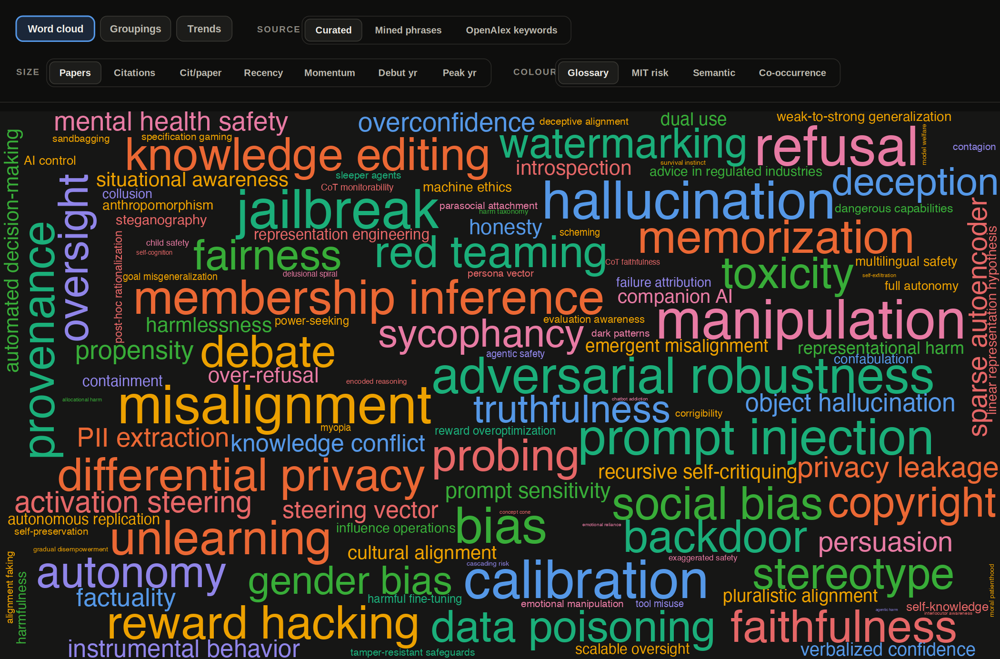

# AI Safety Buzzwords

The vocabulary of AI safety, counted. 125 concepts from a hand-curated glossary, one Semantic
Scholar query each, narrowed to arXiv: **4,726 papers** and **744,271 citations** over
**2005-2026**. Three interactive pages sit on top of those numbers - a word cloud, a trends
view and a groupings map - and every one of them can be re-sized, re-coloured and re-sourced,
which is the point: change a setting and a different term comes out biggest.



## Look at it

The pages are live at **[mrswallbreakermaps.com/buzzwords](https://mrswallbreakermaps.com/buzzwords/index.html)**:

| Page | What it shows |
|---|---|
| [Word cloud](https://mrswallbreakermaps.com/buzzwords/index.html) | every term as a tile, sized by one of 7 metrics, coloured by one of 4 groupings |
| [Trends](https://mrswallbreakermaps.com/buzzwords/trends.html) | per-term heat strips, overlaid year curves, and the field's composition over time |
| [Groupings](https://mrswallbreakermaps.com/buzzwords/taxonomy.html) | one scatter map: position by one grouping, colour by another, radius by a metric |

The same three pages are committed here as self-contained files in [web/](web/) - no server, no
network, open them in a browser.

## Read about it

- **The write-up** - what broke while building this: [post-en.md](post-en.md) (Russian: [post.md](post.md))
- **Methodology** - collection, filtering, the 7 metrics, the 4 groupings, known limits: [methodology_en.md](methodology_en.md) (Russian: [methodology.md](methodology.md))
- **The glossary** - the 125 concepts with definitions and links, which is where the term list comes from: [ai-safety-concepts-glossary_en.md](ai-safety-concepts-glossary_en.md) (Russian: [ai-safety-concepts-glossary.md](ai-safety-concepts-glossary.md))

## What is in this repository

```
ai-safety-concepts-glossary*.md   the 125 concepts, definitions and links - the source of the term list
data/                             the measurements the pages are built from, and the 4,726-paper table
templates/                        the three page templates
src/                              four scripts that fill those templates from data/
web/                              the three built pages, self-contained
img/                              the figures used in the write-up
methodology*.md, post*.md         the method and the write-up
```

The programs that collected and analysed the papers are not here. This repository holds what
they produced: the measurements, the pages, and the writing about both. How the measurements
were made is [methodology_en.md](methodology_en.md).

## Rebuild the pages

The three builders read only what is already committed in `data/` and run on the Python
standard library - nothing to install:

```bash
python src/build_dashboard.py   # -> web/index.html
python src/build_trends.py      # -> web/trends.html
python src/build_taxonomy.py    # -> web/taxonomy.html
```

Each fills the matching template in `templates/` with the data for all three sources and writes
one self-contained file. Edit a template and rerun the builder to change how a page looks; the
numbers come from `data/` untouched.

## One caveat worth reading before quoting a number

Retrieval stops at 1000 candidates per query. For the highest-volume terms - `bias`,
`hallucination` - that ceiling is well below the real paper count, so their weight is
understated in every metric and every chart. The numbers behind the biggest words on the
cloud are the ones I would not quote on their own. The other limits are in
[section 11 of the methodology](methodology_en.md#11-known-limitations).

## Licence

The page builders in `src/` and the templates are MIT. The writing, the glossary, the figures, the built pages
and the derived measurements are CC BY 4.0. The upstream services that the measurements come
from set their own terms - see [LICENSE](LICENSE) for all of it.
