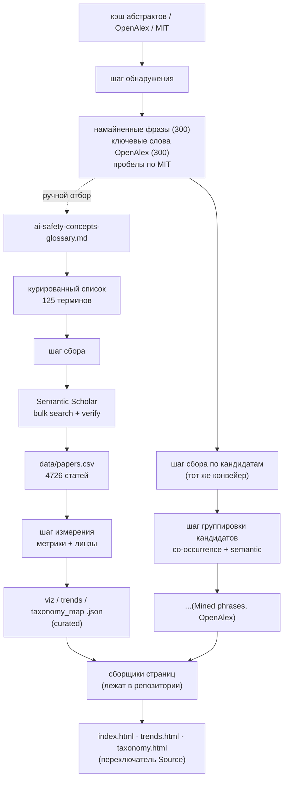

# Методология: как мы собираем и визуализируем баззворды AI Safety

Документ описывает весь конвейер: откуда берутся термины, как по ним собираются статьи, как
отсеивается шум, какие метрики и группировки считаются, как это визуализируется и как искать
новые баззворды. Сопутствующий словарь концептов —
[ai-safety-concepts-glossary.md](ai-safety-concepts-glossary.md). English version:
[methodology_en.md](methodology_en.md).

Программ сбора и анализа в этом репозитории нет. Здесь лежит то, что они произвели, — измерения
в `data/` и три страницы, собранные из них, — чтобы числа можно было проверить и переиспользовать,
ничего не перезапуская (§12).

---

## 1. Цель и три слоя

Для каждого концепта AI Safety получить измеримую картину: сколько по нему статей на arXiv, насколько он «горячий» (цитирования), когда появился, в какой группе живёт — и всё это отрисовать интерактивно.

За этим стоят три слоя работы:

- **Top-down сбор** (§3–§6) — по фиксированному курированному списку из словаря.
- **Bottom-up обнаружение** (§10) — вытаскивание кандидатов из корпусов и таксономий. Эти кандидаты используются двояко: (а) для ручного пополнения словаря и (б) как **самостоятельные источники** для визуализации (см. §8).
- **Визуализация** (§9) — облако слов, тренды и карта группировок, с переключением между источниками, метриками и линзами.

---

## 2. Обзор конвейера



---

## 3. Курированный словарь и запросы

Список **курируется из словаря** руками. В каждой строке три вещи: термин, как он показывается,
кластер словаря, к которому он приписан, и запрос, с которым он идет в поиск. Сейчас **125
терминов** по 19 смысловым кластерам (разделы словаря 1–20; §10 «Umbrella taxonomies» —
мета-раздел без терминов).

**Синтаксис запросов.** Запрос строится одним из двух способов:

- **голая фраза** — термин в кавычках, ничего не добавлено. Для специфичных многословных терминов (`"prompt injection"`, `"membership inference"`).
- **суженная фраза** — термин плюс оговорка про safety-контекст. Для общих однословных (`bias`, `probing`, `calibration`), которые без сужения дают много офтопа.

Safety-контекст — это один список из шести фраз, и суженный запрос требует любую из них:

    language model, large language model, LLM, chatbot, AI safety, AI alignment

Верификация в §5 проверяет по тому же списку из шести. Согласованность двух мест ничем не
обеспечена: если поправить одно и забыть другое, статьи соберутся под сужением, по которому их
потом не проверяют.

Синтаксис bulk-поиска: `"фраза"`, `+`(AND), `|`(OR), `-`(NOT), `*`(префикс). Часть терминов имеет
написанный вручную запрос с OR-синонимами (`scheming`, `reward overoptimization`, …).

**Surface-формы.** Один термин пишется по-разному (`dual-use`/`dual use`,
`PII`/`personally identifiable information`), и все написания должны попасть на одну плитку.
Написанная руками таблица задает формы, засчитываемые как попадание; там, где у термина записи
нет, формы выводятся из самого термина. Матчинг регистронезависимый, по границе слова,
**префиксный** — ловит суффиксы (`bias`→`biased`/`biases`), но **не** смену корня
(`hallucination`→`hallucinate`), поэтому такие формы приходится прописывать явно. Поверх
написанной руками таблицы домешивается еще один источник форм — одобренные человеком
семантические синонимы из `data/variants_approved.json`, и этот файл лежит в репозитории (§13).

---

## 4. Сбор статей

На каждый баззворд:

1. **Retrieval.** Один bulk-вызов Semantic Scholar: `year=2005-`, `fieldsOfStudy=Computer Science`, `sort=citationCount:desc` (для `scheming` — сортировка по дате публикации), поля `title, abstract, year, publicationDate, citationCount, externalIds`. До 1000 кандидатов **с абстрактами**.
2. **Кэш** ответа по каждому термину на диск; повторный запуск читает кэш.
3. Пауза 1.2 c между вызовами. Ответ `429` (превышен лимит запросов) отлеживается и повторяется, с учетом `Retry-After`; любая другая ошибка останавливает прогон на том вызове, где случилась, а кэш делает повторный запуск дешевым.

**Ключ Semantic Scholar не обязателен.** Оба эндпоинта отвечают и без авторизации, из общего пула
лимитов, так что прогон без ключа работает — просто медленнее. Ключ читается из переменной
окружения и никогда не пишется в файл.

## 5. Фильтрация и верификация

S2 матчит **со стеммингом**, поэтому сырой ответ шумит. Три фильтра:

1. **Только arXiv** — статьи с `externalIds.ArXiv`.
2. **Точная фраза** — в `title + abstract` встречается surface-форма как целое слово, из тех, что перечислены для термина в §3. Убирает стемминг-ложняки (`scheme` ≠ `scheming`).
3. **Safety-контекст** (для терминов с суженным запросом) — требуем хотя бы одну из шести фраз контекста. Без него под `bias`/`backdoor`/`probing` пролезали beamforming, DOA-estimation, медицина, IoT.

Итог курированного слоя: **125 терминов → 4 726 уникальных arXiv-статей** (`data/papers.csv`, top-60 по цитированиям на термин, дедуп).

---

## 6. Метрики (7 «весов»)

Считаются на каждый термин; в артефактах любой можно выбрать для размера/сортировки:

| Метрика | Смысл |
|---|---|
| **Papers** | число верифицированных arXiv-статей (основной вес) |
| **Citations** | сумма цитирований этих статей |
| **Citations / paper** | средняя цитируемость (импакт на статью) |
| **Recency** | доля статей с 2024+ (%) — «свежесть» |
| **Momentum** | число статей с 2024+ (недавний объём) |
| **Debut yr** | год, когда термин набрал ≥2 статей |
| **Peak yr** | год пика по числу статей |

Плюс временной ряд по годам (2015–2026) — статьи и цитаты на год, для трендов.

> Оговорка про цитаты: S2 отдаёт **текущий** total, поэтому «citations в год Y» = цитаты статей, **опубликованных** в Y (импакт когорты), а не накопление по годам.

---

## 7. Группировки (линзы)

Термины раскрашиваются и раскладываются по одной из **линз**. У курированного набора их
четыре. Три едут в репозитории файлами `grouping_*.json` в `data/`; четвертая, глоссарная, —
это ручная группировка кластеров по темам, поэтому страницы несут ее внутри своих данных, а не
отдельным файлом:

| Линза | Как считается |
|---|---|
| **Glossary** | 20 кластеров словаря → 8 макро-тем (ручная группировка) |
| **MIT risk** | маппинг кластеров на таксономию MIT AI Risk Repository ([arXiv:2408.12622](https://arxiv.org/abs/2408.12622)), 7 доменов / 24 субдомена |
| **Semantic** | эмбеддинги статей **SPECTER2** (S2) → усреднение по термину → k-means + PCA-2D |
| **Co-occurrence** | граф со-встречаемости терминов в статьях → Louvain-сообщества |

Ключевой приём карты: **Layout = Colour** → чистые одноцветные кластеры (группировка «настоящая»); **Layout ≠ Colour** → видно, как одна группировка режет другую.

---

## 8. Три источника визуализации

Артефакты умеют переключать **источник** — не только курированный словарь, но и bottom-up кандидаты, прогнанные через тот же пайплайн:

| Источник | Метод | Терминов | Статей | Линзы |
|---|---|---|---|---|
| **Curated** | ручной словарь (§3–5) | 125 | 4 726 | glossary · MIT · semantic · co-occurrence |
| **Mined phrases** | частые фразы, намайненные из собранных абстрактов (§10) | 278 | 11 583 | co-occurrence · semantic |
| **OpenAlex keywords** | keywords/topics из OpenAlex | 203 | 6 195 | co-occurrence · semantic |

### Как собираются candidate-источники

1. Из каждого списка обнаружения берется **топ-300** по частоте (дедуп, длина ≥3).
2. Каждая фраза идет по тому же пути, что и §4: bulk-поиск голой фразы, `year=2005-`, Computer Science, **верификация точным вхождением** в title+abstract.
3. На выходе `terms.json` (метрики и ряды по годам на термин) и `papers.csv` (top-60 на термин, дедуп) — оба лежат в репозитории, в `data/src_raw2/` и `data/src_openalex/`.

**Почему не ровно 300.** Из 300 кандидатов остаётся меньше — это **легитимный отсев верификацией**, не сбой:
- raw2: 300 → **278** (−22: n-граммы со «склеенной» аббревиатурой, `retrieval-augmented generation rag`, `vision-language models vlms` — дословно в абстрактах не встречаются, там `... (RAG)` со скобками);
- OpenAlex: 300 → **203** (−97: длинные названия топиков и поля со скобками, `risk analysis (engineering)`, `context (archaeology)` — не встречаются дословно в CS-arXiv). Плюс по 1 фразе на источник упало на 429 при сборе.

### Группировки для candidate-источников

Glossary и MIT привязаны к нашему словарю и к чужим терминам неприменимы. Считаются две линзы:
- **Co-occurrence** — поиск сообществ алгоритмом Louvain по графу, где два термина связаны, когда одна статья упоминает оба (локально, без обращений к API);
- **Semantic** — SPECTER2-эмбеддинги статей источника, вытянутые одним пакетным запросом, дальше k-means и двумерная PCA.

Плюс на выходе те же форматы, что у curated: `viz_data.json`, `trends_data.json`, `taxonomy_map.json` (облака-SVG на каждую из 7 метрик, потоки по годам, раскладки для карты).

---

## 9. Артефакты (три страницы)

Все страницы читают одни и те же per-source данные и делят навигацию + переключатель **Source** (Curated / Mined phrases / OpenAlex).

- **Word cloud** ([src/build_dashboard.py](src/build_dashboard.py) → `index.html`) — интерактивное SVG-облако (размер по любой из 7 метрик, цвет по любой линзе) + бары топ-терминов. Плитки: терминов / статей / цитат / диапазон лет.
- **Trends** ([src/build_trends.py](src/build_trends.py) → `trends.html`) — три вида: **Atlas** (heatmap/cards — все термины на одном экране, теплополоса по годам), **Overlay** (все линии сразу, группы прячутся «глазиком»), **Themes** (стримграф состава поля во времени, papers/citations).
- **Groupings** ([src/build_taxonomy.py](src/build_taxonomy.py) → `taxonomy.html`) — одна карта-scatter: **Layout** (позиция по линзе) × **Colour** (цвет по линзе) × **Size** (радиус по метрике).

Общие контролы: **Source**, **Size** (7 метрик), **Colour**/**Layout** (линзы), тема (свет/тьма).

Разметка каждой страницы лежит в `templates/<page>.html`; [src/page.py](src/page.py) встраивает
в нее все доступные источники одной JS-константой и пишет самодостаточный результат в
`web/<page>.html`. То есть файлы в `web/` — это результат сборки: править нужно шаблон.

---

## 10. Обнаружение кандидатов

Top-down сбор по построению не находит новых терминов. Отдельный шаг идет в обратную сторону, по трем источникам; кандидат проходит, если **новый** — его нет ни в тексте словаря, ни среди курированных терминов и их surface-форм:

| Источник | Где ищет | Что делает | Что выходит |
|---|---|---|---|
| Намайненные фразы | кэш абстрактов из §4 | би- и три-граммы из абстрактов, ранг по частоте, вычет известного | ранжированный список фраз |
| OpenAlex | [OpenAlex API](https://api.openalex.org) | поля `keywords`/`topics` работ по safety-запросу, агрегат по частоте | ранжированный список ключевых слов |
| Таксономия рисков MIT | MIT AI Risk Repository | разность 7 доменов / 24 субдоменов и словаря | лист пробелов в покрытии |

Все три выходят ранжированными, и автоматически из них не происходит ничего: термин попадает в
словарь, когда его туда кто-то заносит. Дальше списки идут двумя путями сразу: часть терминов
руками заносится в словарь, а списки намайненных фраз и ключевых слов целиком становятся
источниками визуализации (§8). За MIT нет статей, поэтому он остается листом покрытия.

Три ранжированных списка — рабочие листы на ревью, а не результат, поэтому в репозитории их нет
(§12). Зато есть то, что из них вышло: два candidate-источника в `data/src_raw2/` и
`data/src_openalex/`.

---

## 11. Известные ограничения

- **Глубина ретрива** — 1000 кандидатов на запрос; для массовых терминов (`bias`, `hallucination`) вес занижен.
- **Верификация точной фразой** режет n-граммы со склеенными аббревиатурами и длинные названия топиков — часть кандидатов законно отваливается (§8).
- **candidate-источники шумны:** raw2 содержит генерик-фразы (`findings suggest`), OpenAlex — широкие поля (`computer science`, `psychology`). Это ожидаемо — «что корпус выдаёт сам по себе».
- **Semantic по годам:** «citations» = импакт когорты по году публикации, не накопление.
- **Сырое число попаданий**, которое Semantic Scholar сообщает по запросу, несравнимо между терминами из-за стемминга — сравнивать только по проверенному счету, то есть по метрике **Papers**.
- **glossary/MIT не существуют** для candidate-источников — у них только co-occurrence + semantic.

---

## 12. Что лежит в этом репозитории

В `data/` лежат готовые измерения: `papers.csv` (корпус из 4726 статей), `viz_data.json`,
`trends_data.json`, `taxonomy_map.json`, `variants_approved.json` и три файла линз
`grouping_cooccur.json`, `grouping_embed.json`, `grouping_mit.json`. У каждого
candidate-источника свой набор поменьше в `data/src_raw2/` и `data/src_openalex/`: `papers.csv`,
`terms.json`, `viz_data.json`, `trends_data.json`, `taxonomy_map.json`. Вместе это все числа,
которые показывает любая из трех страниц.

Программ сбора и анализа здесь нет, и их рабочих файлов тоже: кэша ответов Semantic Scholar по
терминам, векторов SPECTER2 и ранжированных листов на ревью из §10 и §13. Все они пересобираются
из API на каждом прогоне, и ни один из них не нужен, чтобы прочитать, проверить или
переиспользовать измерения.

### Как пересобрать страницы

Три сборщика страниц лежат в репозитории, читают только `data/` и работают на стандартной
библиотеке Python — ставить ничего не нужно:

```bash
python src/build_dashboard.py   # -> web/index.html
python src/build_trends.py      # -> web/trends.html
python src/build_taxonomy.py    # -> web/taxonomy.html
```

Каждый заполняет свой шаблон из `templates/` данными по всем трем источникам и пишет один
самодостаточный файл. Поправить шаблон и перезапустить сборщик — это и есть способ изменить вид
страницы; числа при этом берутся из `data/` нетронутыми.

---

## 13. Работа по обогащению и что осталось

- **Семантическое обогащение surface-форм (сделано).** Синонимы ловятся, только если прописаны, поэтому статья с непрописанным синонимом молча пропускалась, и счетчик выходил ниже настоящего. У каждого термина есть центроид в пространстве SPECTER2, mean-centered по корпусу; ранжирование n-грамм корпуса по косинусу к этому центроиду кладет вероятные пропущенные синонимы наверх листа на ревью. Одобренные формы — почищены человеком, защищены от раздувания метрик блок-листом генерик-корней **и** эмпирической проверкой контаминации по кэшу (она поймала, например, что «harmful content» тянет jailbreak-статьи в *harmfulness*) — лежат в `data/variants_approved.json`, этот файл в репозитории есть, и домешиваются к surface-формам из §3. Применённый эффект: **+741 верифицированная статья (+8.4%)** на 37 терминах (напр. `memorize`/`memorized` для *memorization*, `hallucinate` для *hallucination*). Не авто-инжект — человек в петле.
- **Триаж кандидатов (сделано).** Шаг триажа проецирует bottom-up источники на 125 курированных баззвордов через mean-centered SPECTER2-косинус и раскладывает каждого кандидата по четырем корзинам — вариант, родственное, новый кандидат, отброс, — используя близость для дедупа, когерентность, чтобы отличить концепт от шума, и порог по числу статей для остального. Выходит один размеченный лист для курации.
- **Сверка с OpenAlex (не сделано).** Для терминов с идентификатором топика в OpenAlex можно запросить работы под этим топиком и получить счетчик, который ничем не обязан нашему списку surface-форм; сильное расхождение с нашим проверенным счетом укажет либо на пропущенную форму, либо на несовпадение сужения. Только диагностика — в основной счетчик не подмешивается.
