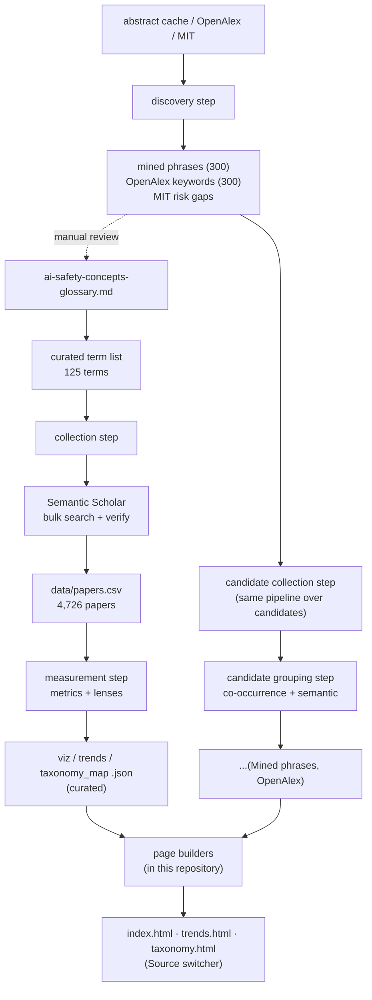

# Methodology: how we collect and visualize AI-safety buzzwords

Terms come from the companion glossary,
[ai-safety-concepts-glossary_en.md](ai-safety-concepts-glossary_en.md). Everything below is the
method between that list and the three pages: what was queried, what was thrown away, what was
counted and how the terms were grouped.

The collection and analysis programs are not in this repository. What travels here is what they
produced - the measurements in `data/` and the three pages built from them - so that the numbers
can be checked and reused without rerunning anything (§12).

---

## 1. Goal and three layers

A tile in the cloud needs a paper count behind it, then the citations on those papers, the year the term first showed up, and a cluster to colour it by. The cloud sizes each tile off whichever of those numbers is selected. Anything that resists being counted has no route onto a page, and I have not gone looking for one.

Three layers of work sit behind that:

| Layer | What it works over | Where |
|---|---|---|
| Top-down collection | a fixed, curated list of AI-safety concepts taken from the glossary | §3-§6 |
| Bottom-up discovery | corpora and taxonomies, searched for candidate terms nobody had listed | §10 |
| Visualization | the word cloud, the trends view and the groupings map | §9 |

Discovery feeds two things that have nothing to do with each other: single terms get hand-added to the glossary, and the lists as a whole become **standalone sources** for the pages (§8).

---

## 2. Pipeline overview



---

## 3. Curated vocabulary and queries

The curated term list is built by hand out of the glossary. Each row holds three things - the term as displayed, the glossary cluster it belongs to, and the search query it goes out with - and there are **125 terms** over 19 semantic clusters. The clusters are glossary sections 1-20, minus §10 "Umbrella taxonomies", which tracks no terms of its own.

A query is built one of two ways:

| Query form | What it is | Used for |
|---|---|---|
| bare phrase | the term in quotes, nothing added | specific multi-word terms - `"prompt injection"`, `"membership inference"` |
| scoped phrase | the term plus a safety context clause | generic single-word terms - `bias`, `probing`, `calibration` - which unscoped come back full of off-topic hits |

The safety context is one list of six phrases, and the scoped query asks for any of them:

    language model, large language model, LLM, chatbot, AI safety, AI alignment

Verification in §5 checks against that same list of six. Nothing enforces that the two stay in step - if one is edited and the other is not, papers get collected under a scope they are then not checked against.

The bulk search syntax offers `"phrase"`, `+`(AND), `|`(OR), `-`(NOT), `*`(prefix). A handful of terms carry a hand-written query with OR-synonyms instead of either standard form (`scheming`, `reward overoptimization`, ...).

Surface forms. A term can be written several ways - `dual-use`/`dual use`, `PII`/`personally identifiable information` - and they all have to land on one tile. A hand-written table lists the forms that count as a hit for a given term; where a term has no entry, the forms are derived from the term itself. Matching is case-insensitive, on a word boundary, and **prefix-based**:

| Change | Example | Caught |
|---|---|---|
| glued on the right | `bias`→`biased`/`biases` | yes |
| inside the stem | `hallucination`→`hallucinate` | no, has to be listed by hand |

One more source of forms is merged on top of the hand-written table: the approved semantic synonyms in `data/variants_approved.json`, which is in this repository (§13). Which terms are still short a form, I have not checked.

---

## 4. Collecting papers

One Semantic Scholar bulk call per term, on the parameters below, cached per term to disk so that a rerun costs nothing:

| Call parameter | Value |
|---|---|
| `year` | `2005-` |
| `fieldsOfStudy` | `Computer Science` |
| `sort` | `citationCount:desc`, except `scheming`, sorted by publication date instead |
| fields | `title, abstract, year, publicationDate, citationCount, externalIds` |
| ceiling | up to 1000 candidates, all of them **with abstracts** |

Between calls, a 1.2 second pause and up to 5 retries with backoff when one errors out. The Semantic Scholar key is read from the environment, never written into a file; without a key the collection still runs, on a lower rate limit.

## 5. Filtering and verification

S2 matches **with stemming**, so what comes back is noisy. Three filters run over it, in this order:

| Filter | What it drops | Note |
|---|---|---|
| no `externalIds.ArXiv` | everything not on arXiv | |
| surface form not in `title + abstract` as a whole word | the stemming false positives: `scheme` ≠ `scheming` | checked against the term's surface forms from §3 |
| none of the six safety context phrases present | off-topic hits, but only for terms whose query was scoped | before it existed, `bias`/`backdoor`/`probing` were pulling in beamforming, DOA estimation, medicine, IoT |

**125 terms → 4,726 unique arXiv papers** survive that (`data/papers.csv`, top-60 by citations per term, deduplicated). It is the Curated row of the source table in §8.

---

## 6. Metrics (7 "weights")

Seven of them, computed per term. Any one can size a tile in the cloud or re-sort the bar chart; **Papers** is the primary weight.

| Metric | Meaning |
|---|---|
| **Papers** | verified arXiv papers, after the three filters above |
| **Citations** | their citations summed, as S2 reports them on the day of collection. A **current** total, so "citations in year Y" = citations of papers **published** in Y (cohort impact), not year-by-year accrual |
| **Citations / paper** | the same sum over the same set, averaged |
| **Recency** | share of papers from 2024+ (%). A small term can sit high here and near the bottom of Momentum |
| **Momentum** | count of papers from 2024+, same cut-off as Recency, counted instead of shared |
| **Debut yr** | year the term first reached ≥2 papers, so one stray paper cannot set it |
| **Peak yr** | year of the papers-per-year peak |

Each term also carries a per-year series, 2015-2026, papers and citations both, which is what trends reads.

---

## 7. Groupings (lenses)

Four **lenses** colour and lay out the curated set. Three of them travel with this repository as the `grouping_*.json` files in `data/`; the fourth, the glossary one, is a hand-written grouping of clusters into themes, which is why the pages carry it inside their own data rather than as a file:

| Lens | How it's computed |
|---|---|
| **Glossary** | 20 glossary clusters → 8 macro-themes, grouped by hand over our own clusters; changing it is an edit to a file, not a rerun |
| **MIT risk** | mapping clusters onto the MIT AI Risk Repository taxonomy ([arXiv:2408.12622](https://arxiv.org/abs/2408.12622)), 7 domains / 24 subdomains, hand-written the same way |
| **Semantic** | paper embeddings **SPECTER2** (S2) → averaged per term → k-means + PCA-2D |
| **Co-occurrence** | term co-occurrence graph over papers → Louvain communities. This one and Semantic come out of the papers with nobody in the loop |

---

## 8. Three visualization sources

The **source** switch on every page swaps the whole vocabulary underneath it: the curated glossary, or bottom-up candidates put through the same pipeline.

| Source | Method | Terms | Papers | Lenses | Lost in verification |
|---|---|---|---|---|---|
| **Curated** | manual glossary (§3-5) | 125 | 4,726 | glossary · MIT · semantic · co-occurrence | - |
| **Mined phrases** | frequent phrases mined from the collected abstracts (§10) | 278 | 11,583 | co-occurrence · semantic | −22 of the top 300: n-gram artifacts with an acronym glued on, `retrieval-augmented generation rag`, `vision-language models vlms`. Abstracts write `... (RAG)` in parentheses, so the phrase is never there verbatim |
| **OpenAlex keywords** | keywords/topics from OpenAlex | 203 | 6,195 | co-occurrence · semantic | −97 of the top 300: long topic labels and parenthetical fields, `risk analysis (engineering)`, `context (archaeology)`, none of them present verbatim in CS arXiv |

Neither candidate source reaches 300; the Lost in verification column is where the rest went. 1 phrase per source also died on a 429 mid-collection, which is a bug rather than a filter and has not been retried.

### How candidate sources are collected

The top 300 by frequency out of each discovery list, deduplicated, three characters or longer. Each phrase then goes down the §4 path unchanged: bulk search on the bare phrase, `year=2005-`, Computer Science, **exact-phrase verification** in title and abstract. What comes out is `terms.json` (per-term metrics and per-year series) and `papers.csv` (top 60 per term, deduplicated), both of which are in this repository under `data/src_raw2/` and `data/src_openalex/`.

### Groupings for candidate sources

The glossary and MIT lenses are tied to our own vocabulary, so foreign terms get neither, and only the other two are computed. Co-occurrence is Louvain community detection over the graph where two terms are linked when one paper mentions both - local, no API. Semantic needs SPECTER2 embeddings of the source's papers, pulled in one Semantic Scholar batch, then k-means and a two-dimensional PCA.

Output formats match the curated ones: `viz_data.json`, `trends_data.json`, `taxonomy_map.json` - cloud SVGs for each of the 7 metrics, per-year streams, map layouts.

---

## 9. Artifacts (three pages)

All three pages read the same per-source data and share a nav, a light/dark theme and the **Source** switcher (Curated / Mined phrases / OpenAlex).

The word cloud ([build_dashboard.py](src/build_dashboard.py) → `index.html`) is the page that gets looked at. Every term is a tile in an interactive SVG cloud, sized by whichever of the 7 metrics is selected and coloured by whichever lens; a top-terms bar chart under it re-sorts on the same metric. Four stat tiles: terms, papers, citations, year span.

Trends ([build_trends.py](src/build_trends.py) → `trends.html`) has three views. **Atlas** is heatmap cards, every term on one screen with a per-year heat-strip. **Overlay** draws all the lines at once and hides groups behind an "eye". **Themes** is a streamgraph of the field's composition over time, papers or citations.

Groupings ([build_taxonomy.py](src/build_taxonomy.py) → `taxonomy.html`) is a single scatter map: **Layout** positions by a lens, **Colour** colours by a lens, **Size** is the radius by metric. Set Layout and Colour to the same lens and the clusters come out in clean single colours, which is what a grouping looks like when it is real; set them to different ones and you get how one grouping cuts across the other.

---

## 10. Discovering candidates

Top-down collection by design cannot find new terms. A separate step goes the other way, over three sources; a candidate passes if it is **novel**, meaning it appears neither in the glossary text nor among the curated terms and their surface forms:

| Source | Where it looks | What it does | What comes out |
|---|---|---|---|
| Mined phrases | the cached abstracts from §4 | two- and three-word phrases from abstracts, ranked by frequency, minus the known terms | a ranked list of mined phrases |
| OpenAlex | [OpenAlex API](https://api.openalex.org) | keywords and topics of works matching a safety query, aggregated by frequency | a ranked list of keywords |
| MIT risk taxonomy | MIT AI Risk Repository | difference between its 7 domains / 24 subdomains and the glossary | a coverage sheet of gaps |

All three come out ranked and none of them is automatic - a term enters the glossary when someone puts it there. From that point the mined phrases and the OpenAlex keywords go two ways at once: individual terms get promoted by hand, and the same lists whole become visualization sources (§8). The MIT difference has no papers behind it, so it stays a coverage sheet.

The three ranked lists are working sheets for review, not results, so they do not travel with this repository (§12). What did come of them is here: the two candidate sources under `data/src_raw2/` and `data/src_openalex/`.

---

## 11. Known limitations

Retrieval stops at 1000 candidates per query. For `bias` or `hallucination` that is nowhere near the real volume, so their weight is understated in every metric and every chart that reads one - the numbers on this repo's biggest terms are the ones I would not quote on their own.

Two smaller ones:

- The raw hit count Semantic Scholar reports for a query is not comparable across terms, because it stems. The verified count - the **Papers** metric - is the one to compare.
- The candidate sources are noisy by construction. raw2 carries generic phrases (`findings suggest`), OpenAlex carries entire fields (`computer science`, `psychology`).

And on the groupings map, Mined phrases and OpenAlex keywords can only be laid out and coloured by co-occurrence or semantic. The glossary and MIT lenses do not exist for them, so two of the four entries do nothing while either one is the source.

---

## 12. What travels with this repository

`data/` holds the finished measurements: `papers.csv` (the 4,726-paper corpus), `viz_data.json`,
`trends_data.json`, `taxonomy_map.json`, `variants_approved.json`, and the three lens files
`grouping_cooccur.json`, `grouping_embed.json`, `grouping_mit.json`. Each candidate source
carries its own smaller set under `data/src_raw2/` and `data/src_openalex/`: `papers.csv`,
`terms.json`, `viz_data.json`, `trends_data.json`, `taxonomy_map.json`. Between them that is
every number any of the three pages shows.

The collection and analysis programs are not here, and neither are their working files: the
per-term cache of Semantic Scholar responses, the SPECTER2 vectors, and the ranked review sheets
of §10 and §13. They are all rebuilt from the APIs on every run, and none of them is needed to
read, check or reuse the measurements.

### Rebuilding the pages

The three page builders are in this repository, they read `data/` and nothing else, and they run
on the Python standard library - no install step:

```bash
python src/build_dashboard.py   # -> web/index.html
python src/build_trends.py      # -> web/trends.html
python src/build_taxonomy.py    # -> web/taxonomy.html
```

Each one fills the matching template in `templates/` with the data for all three sources and
writes a single self-contained file. Editing a template and rerunning the builder is the way to
change how a page looks; the numbers it shows come from `data/` untouched.

---

## 13. Enrichment work and what is left

Semantic enrichment of the surface forms. Each term has a centroid in SPECTER2 space, mean-centered over the corpus; ranking the corpus n-grams by cosine against that centroid puts the likeliest missing synonyms at the top of a review sheet. Pruning is manual - a form reaches the counts once someone has approved the row.

An unlisted synonym is a paper that never gets counted, and the number just comes back lower. Two guards sit under the suggestions. One is a generic-root blocklist. The other re-runs the proposed form over the cached candidates to see what it drags in, and that is what caught "harmful content" quietly pulling jailbreak papers into *harmfulness*. Survivors land in `data/variants_approved.json`, which is in this repository, and get merged into the surface forms of §3.

Across 37 terms the effect was **+741 verified papers (+8.4%)**, most of it the stem changes the prefix matcher can never see: `memorize`/`memorized` for *memorization*, `hallucinate` for *hallucination*. Which terms are still missing one, nobody has gone through and checked.

Candidate triage produces one row per candidate, one table to curate from. It scores the two bottom-up sources against the 125 curated terms on mean-centered SPECTER2 cosine, then sorts each candidate into one of four buckets - variant, related, new candidate, discard - using proximity to remove duplicates, coherence to tell a concept from noise, and a minimum paper count for the rest.

Cross-source validation via OpenAlex: nothing done yet. For terms carrying an OpenAlex topic identifier, asking OpenAlex for the works under that topic gives a count that owes nothing to our list of surface forms, and a large gap against our verified count would point at either a missing form or a mismatch of scope. Whether that belongs beside the verified count as a column, or outside the tables entirely, I have not worked out.
