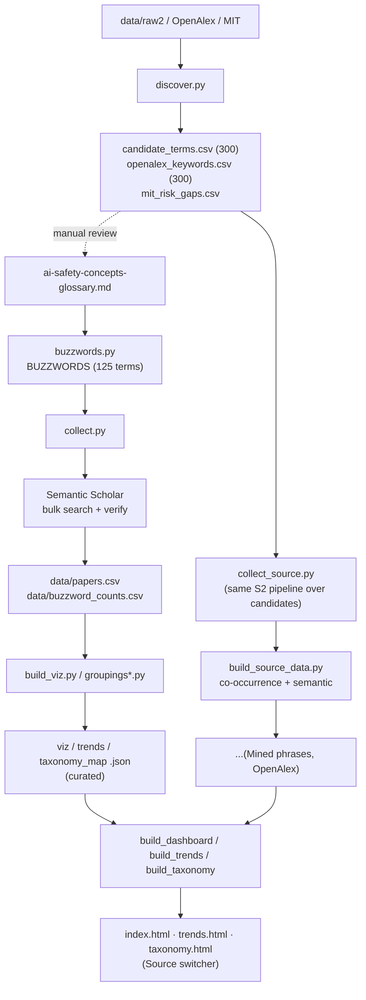

# Methodology: how we collect and visualize AI-safety buzzwords

Terms come from the companion glossary, [ai-safety-concepts-glossary_en.md](ai-safety-concepts-glossary_en.md). Everything below is the code between that list and the three pages.

---

## 1. Goal and three layers

A tile in the cloud needs a paper count behind it, then the citations on those papers, the year the term first showed up, and a cluster to colour it by. The cloud sizes each tile off whichever of those numbers is selected. Anything that resists being counted has no route onto a page, and I have not gone looking for one.

Which script does what:

| Layer | Scripts | Over what |
|---|---|---|
| Top-down collection | [buzzwords.py](buzzwords.py) + [collect.py](collect.py) | a fixed, curated list of AI-safety concepts from the glossary (§3-§6) |
| Bottom-up discovery | [discover.py](discover.py) | corpora and taxonomies, for candidate terms (§10) |
| Visualization | [build_viz.py](build_viz.py), [build_source_data.py](build_source_data.py), [build_dashboard.py](build_dashboard.py) / [build_trends.py](build_trends.py) / [build_taxonomy.py](build_taxonomy.py) | word cloud, trends, groupings map (§9) |

Discovery feeds two things that have nothing to do with each other: single terms get hand-added to the glossary, and the lists as a whole become **standalone sources** for the pages (§8).

---

## 2. Pipeline overview



---

## 3. Curated vocabulary and queries - `buzzwords.py`

`BUZZWORDS` is the list, curated by hand out of the glossary: rows of `(display_term, cluster, s2_query)`, **125 terms** over 19 semantic clusters. The clusters are glossary sections 1-20, minus §10 "Umbrella taxonomies", which tracks no terms of its own.

Two helpers build the query:

| Helper | What it builds | For |
|---|---|---|
| `p(term)` | a "bare" quoted phrase | specific multi-word terms - `"prompt injection"`, `"membership inference"` |
| `s(term)` | the phrase **scoped with safety context** `SCOPE` | generic single-word terms - `bias`, `probing`, `calibration` - which unscoped come back full of off-topic hits |

`SCOPE` is built from the single `CONTEXT` list below. Section 5 verifies against that same list, and nothing checks that the two stay in step:

```10:12:buzzwords.py
CONTEXT = ["language model", "large language model", "LLM", "chatbot",
           "AI safety", "AI alignment"]
SCOPE = "(%s)" % " | ".join('"%s"' % c if " " in c else c for c in CONTEXT)
```

S2 bulk syntax: `"phrase"`, `+`(AND), `|`(OR), `-`(NOT), `*`(prefix). A handful of rows carry a custom query with OR-synonyms instead of either helper (`scheming`, `reward overoptimization`, ...).

Surface forms, `VARIANTS` and `variants()`. A term can be written several ways - `dual-use`/`dual use`, `PII`/`personally identifiable information` - and they all have to land on one tile. `VARIANTS` defines the forms that count as a hit; otherwise `variants()` auto-derives them. Matching is case-insensitive, on a word boundary, and **prefix-based**:

| Change | Example | Caught |
|---|---|---|
| glued on the right | `bias`→`biased`/`biases` | yes |
| inside the stem | `hallucination`→`hallucinate` | no, has to be listed by hand |

`variants()` merges one more source on top of `VARIANTS` - the human-approved semantic synonyms in `data/variants_approved.json` (§13). Which terms are still short a form, I have not checked.

---

## 4. Collecting papers - `collect.py`

One S2 bulk call per buzzword, on the parameters below, cached to `data/raw2/<slug>.json` so that a rerun costs nothing:

| Call parameter | Value |
|---|---|
| `year` | `2005-` |
| `fieldsOfStudy` | `Computer Science` |
| `sort` | `citationCount:desc`, except `scheming` at `publicationDate:desc` (`SORT_OVERRIDE`) |
| fields | `title, abstract, year, publicationDate, citationCount, externalIds` |
| ceiling | up to 1000 candidates, all of them **with abstracts** |

Between calls, a 1.2 s pause and up to 5 retries with backoff when one errors out. The S2 key sits in `collect.py`, which is the reason that file lives in the private repo.

## 5. Filtering and verification

S2 matches **with stemming**, so what comes back is noisy. Three filters run over it, in this order:

| Filter | What it drops | Note |
|---|---|---|
| no `externalIds.ArXiv` | everything not on arXiv | |
| surface form not in `title + abstract` as a whole word | the stemming false positives: `scheme` ≠ `scheming` | `make_matcher(variants(term))` |
| no `CONTEXT` token | off-topic hits, but only where the query carried `SCOPE` | before it existed, `bias`/`backdoor`/`probing` were pulling in beamforming, DOA estimation, medicine, IoT |

**125 terms → 4,726 unique arXiv papers** survive that (`data/papers.csv`, top-60 by citations per term, deduplicated). It is the Curated row of the source table in §8.

---

## 6. Metrics (7 "weights")

Seven of them, computed per term. Any one can size a tile in the cloud or re-sort the bar chart; **Papers** is the primary weight.

| Metric | Meaning |
|---|---|
| **Papers** | verified arXiv papers, after the three filters above |
| **Citations** | their citations summed, as S2 reports them on the day of collection. A **current** total, so "citations in year Y" = citations of papers **published** in Y (cohort impact), not year-by-year accrual |
| **Citations / paper** | the same sum over the same set, averaged |
| **Recency** | share of papers from 2024+ (%). A small term can sit high here and near the bottom of Momentum |
| **Momentum** | count of papers from 2024+, same cut-off as Recency, counted instead of shared |
| **Debut yr** | year the term first reached ≥2 papers, so one stray paper cannot set it |
| **Peak yr** | year of the papers-per-year peak |

Each term also carries a per-year series, 2015-2026, papers and citations both, which is what trends reads.

---

## 7. Groupings (lenses)

Four **lenses** colour and lay out the curated set, built in `groupings.py` / `groupings_embed.py` and assembled in `lenses.py`:

| Lens | How it's computed |
|---|---|
| **Glossary** | 20 glossary clusters → 8 macro-themes, grouped by hand over our own clusters; changing it is an edit to a file, not a rerun |
| **MIT risk** | mapping clusters onto the MIT AI Risk Repository taxonomy ([arXiv:2408.12622](https://arxiv.org/abs/2408.12622)), 7 domains / 24 subdomains, hand-written the same way |
| **Semantic** | paper embeddings **SPECTER2** (S2) → averaged per term → k-means + PCA-2D |
| **Co-occurrence** | term co-occurrence graph over papers → Louvain communities. This one and Semantic come out of the papers with nobody in the loop |

---

## 8. Three visualization sources

The **source** switch on every page swaps the whole vocabulary underneath it: the curated glossary, or bottom-up candidates put through the same pipeline.

| Source | Method | Terms | Papers | Lenses | Lost in verification |
|---|---|---|---|---|---|
| **Curated** | manual glossary (§3-5) | 125 | 4,726 | glossary · MIT · semantic · co-occurrence | - |
| **Mined phrases** | frequent phrases from abstracts (`discover.py --source raw2`) | 278 | 11,583 | co-occurrence · semantic | −22 of the top 300: n-gram artifacts with an acronym glued on, `retrieval-augmented generation rag`, `vision-language models vlms`. Abstracts write `... (RAG)` in parentheses, so the phrase is never there verbatim |
| **OpenAlex keywords** | keywords/topics from OpenAlex | 203 | 6,195 | co-occurrence · semantic | −97 of the top 300: long topic labels and parenthetical fields, `risk analysis (engineering)`, `context (archaeology)`, none of them present verbatim in CS arXiv |

Neither candidate source reaches 300; the Lost in verification column is where the rest went. 1 phrase per source also died on a 429 mid-collection, which is a bug rather than a filter and has not been retried.

### How candidate sources are collected - `collect_source.py`

Top 300 by frequency out of `data/candidate_terms.csv` / `data/openalex_keywords.csv`, deduplicated, length ≥3. Each phrase then goes down the `collect.py` path unchanged: bulk search on the bare phrase, `year=2005-`, CS, **exact-phrase verification** in title+abstract. The cache lands in `data/src_<source>/raw/`, and what comes out is `terms.json` (per-term metrics + series) and `papers.csv` (top-60/term, deduplicated).

### Groupings for candidate sources - `build_source_data.py`

Glossary/MIT are tied to our own vocabulary, so foreign terms get neither and the other two lenses are computed here. Co-occurrence is Louvain over the paper co-occurrence graph, local, no API. Semantic needs SPECTER2 embeddings of the source's papers, pulled in one S2 batch and cached in `embeddings.npz`, then k-means + PCA.

Output formats match the curated ones: `viz_data.json`, `trends_data.json`, `taxonomy_map.json` - cloud SVGs for each of the 7 metrics, per-year streams, map layouts.

---

## 9. Artifacts (three pages)

All three pages read the same per-source data and share a nav, a light/dark theme and the **Source** switcher (Curated / Mined phrases / OpenAlex).

The word cloud ([build_dashboard.py](build_dashboard.py) → `index.html`) is the page that gets looked at. Every term is a tile in an interactive SVG cloud, sized by whichever of the 7 metrics is selected and coloured by whichever lens; a top-terms bar chart under it re-sorts on the same metric. Four stat tiles: terms, papers, citations, year span.

Trends ([build_trends.py](build_trends.py) → `trends.html`) has three views. **Atlas** is heatmap cards, every term on one screen with a per-year heat-strip. **Overlay** draws all the lines at once and hides groups behind an "eye". **Themes** is a streamgraph of the field's composition over time, papers or citations.

Groupings ([build_taxonomy.py](build_taxonomy.py) → `taxonomy.html`) is a single scatter map: **Layout** positions by a lens, **Colour** colours by a lens, **Size** is the radius by metric. Set Layout and Colour to the same lens and the clusters come out in clean single colours, which is what a grouping looks like when it is real; set them to different ones and you get how one grouping cuts across the other.

---

## 10. Discovering candidates - `discover.py`

Top-down collection by design can't find new terms. A separate module, three `--source` modes; a candidate passes if it's **novel** (not in the glossary text nor in `BUZZWORDS`/`VARIANTS`):

| Mode | Source | What it does | Output |
|---|---|---|---|
| `raw2` | `data/raw2` cache | 2-3-grams from abstracts, ranked by frequency, minus known terms | `data/candidate_terms.csv` |
| `openalex` | [OpenAlex API](https://api.openalex.org) | `keywords`/`topics` of works matching a safety query, aggregated by frequency | `data/openalex_keywords.csv` |
| `mit` | MIT AI Risk Repository | diff of 7 domains / 24 subdomains against the glossary | `data/mit_risk_gaps.csv` |

Everything in those three files is ranked and nothing in them is automatic - a term enters the glossary when someone puts it there. From that point the raw2 and openalex lists go two ways at once: individual terms get promoted by hand, and the same lists whole become visualization sources (§8). The MIT diff has no papers behind it, so it stays a coverage/gap sheet.

---

## 11. Known limitations

Retrieval stops at 1000 candidates per query. For `bias` or `hallucination` that is nowhere near the real volume, so their weight is understated in every metric and every chart that reads one - the numbers on this repo's biggest terms are the ones I would not quote on their own.

Two smaller ones:

- `raw_s2_total` is not comparable across terms, because S2 stems. Compare `verified`/`Papers`.
- The candidate sources are noisy by construction. raw2 carries generic phrases (`findings suggest`), OpenAlex carries entire fields (`computer science`, `psychology`).

And on the groupings map, Mined phrases and OpenAlex keywords can only be laid out and coloured by co-occurrence or semantic. The glossary and MIT lenses do not exist for them, so two of the four entries do nothing while either one is the source.

---

## 12. How to run

```bash
# - curated layer -
python buzzwords.py            # stats over the list
python collect.py             # collect papers (caches data/raw2)
python build_viz.py           # metrics + clouds + viz_data (+ groupings*.py lenses)
python trends_data.py; python taxonomy_map.py

# - candidate discovery -
python discover.py --source raw2
python discover.py --source openalex --pages 25
python discover.py --source mit

# - candidate sources as corpora -
python collect_source.py raw2 300      # collect + verify top-300
python collect_source.py openalex 300
python build_source_data.py raw2       # co-occurrence + semantic + formats
python build_source_data.py openalex

# - variant / candidate curation (no fetch; reuses cached embeddings) -
python variants_suggest.py    # -> data/variants_suggestions.csv (synonym forms for review)
python build_triage.py        # -> data/candidate_triage.csv (route candidates)

# - build pages (embed all available sources) -
python build_dashboard.py
python build_trends.py
python build_taxonomy.py
```

### How to add a new buzzword (to the curated set)

1. Add a line to `ai-safety-concepts-glossary.md` (canonical name + link).
2. Add a tuple to `BUZZWORDS` (`buzzwords.py`), and surface forms to `VARIANTS` if needed.
3. `python collect.py` → the term is pulled from S2 and enters the metrics; then rebuild the data and pages.

---

## 13. Enrichment tooling and future work

Semantic `VARIANTS` enrichment: `variants_suggest.py` takes each term's mean-centered SPECTER2 centroid and ranks corpus n-grams by cosine against it into `data/variants_suggestions.csv`, closest at the top. Pruning is manual - a form reaches the counts once someone has approved the row.

An unlisted synonym is a paper that never gets counted, and the number just comes back lower. Two guards sit under the suggestions. One is a generic-root blocklist. The other re-runs the proposed form over the cached candidates to see what it drags in, and that is what caught "harmful content" quietly pulling jailbreak papers into *harmfulness*. Survivors land in `data/variants_approved.json` and get merged by `variants()`.

Across 37 terms the effect was **+741 verified papers (+8.4%)**, most of it the stem changes the prefix matcher can never see: `memorize`/`memorized` for *memorization*, `hallucinate` for *hallucination*. Which terms are still missing one, nobody has gone through and checked.

`build_triage.py` writes `data/candidate_triage.csv`, one row per candidate, one table to curate from. It scores the two bottom-up sources (`data/src_raw2`, `data/src_openalex`) against the 125 curated buzzwords on mean-centered SPECTER2 cosine, then sorts each candidate into `{variant, related, new-candidate, discard}` - proximity for the dedup, coherence to tell a concept from noise, a min-papers gate for the rest.

Cross-source validation via OpenAlex: nothing written yet. For terms carrying an OpenAlex topic ID, `works?filter=topics.id:...` gives a count that owes nothing to our `VARIANTS` list, and a large gap against our verified count would point at either a missing surface form or a scope mismatch. Whether it belongs next to `verified` as a column or outside the tables entirely, I haven't worked out.
