# What I learned mapping AI safety buzzwords

The cloud below is 125 AI safety concepts. One Semantic Scholar query each, down to arXiv,
4,726 papers after dedup. Then the other direction, to catch what I'd missed by hand:
abstract-mined phrases, OpenAlex keywords, a diff against the MIT risk taxonomy. The counts are
live at [mrswallbreakermaps.com/buzzwords](https://mrswallbreakermaps.com/buzzwords/index.html).
The rest of this is notes on what went sideways while I built it.

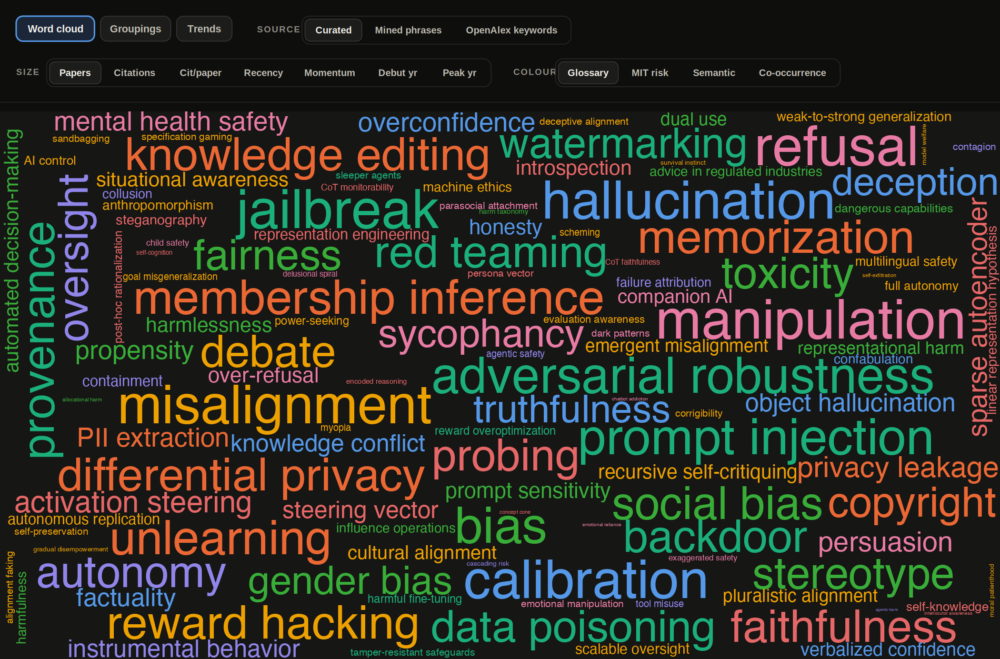

*125 concepts; word size is the number of verified papers and color is the theme. This is one
map out of many: the sizing has seven settings, the coloring four, the source three, and
swapping any of them changes which word comes out biggest. A lot of what's below only shows up
once you start flipping those.*

> On the screenshots: every image keeps the site's control bar along the top, active view
> highlighted, so you can read off the tab plus the Source, Size and Colour it was set to.
> Same settings, same picture. The one above is the Word cloud tab, curated source, sized by
> papers, colored by glossary theme.

---

## 1. One buzzword, three layers, and it's hard to tell which a paper is about

This one cost me a while. Two papers filed under `refusal`, open side by side, measuring
nothing in common. The first is a refusal benchmark, a score over a set of prompts. The second
isn't a score at all, it's a "refusal direction" someone pulled out of the residual stream by
probing. Then a third that's really about the CoT, how the model narrates its way to a refusal
out loud. Same tag on all three.

So the tag hides which of the three places the thing got measured. The first paper? Output, the
answer itself: is it a lie. That's what benchmarks and red-teaming and the odd LLM grader poke
at. The second is down in the activations, a direction inside the hidden states you only reach
with linear probing or SAEs or steering. The third, the CoT one, I trust least. It reads like a
window into the model. But mechanically the chain of thought is just more output, more of it, so
I quit treating it as any kind of inside access.

So before I argue about a buzzword now, I first work out which layer the paper is standing on.
Most of the talking-past-each-other I run into is just two people standing on different layers.

---

## 2. Searching by buzzword is a minefield of homonyms

`scheming`, typed into Semantic Scholar, is where this started. A few hundred hits expected;
38,923 came back. Almost none about scheming. Semantic Scholar had stemmed it - to the engine
`scheming`, `scheme`, `schemes` are one token - and matched that stem clear across computer
science. So the 38,923 are every appearance of the word in any form, any context: signal-processing
routing `scheme`s, networking protocols, all of it, not papers about scheming. Strict pass
instead - the exact phrase, standing alone, a safety context around it. 15 survived, and that 15
is what sizes `scheming` in the cloud above.

The strict pass costs me in the other direction, and I saw that one much later. It matches the
phrase as typed, so the form I typed is the form I got. For `hallucination` I typed the noun.
Papers that only ever write `hallucinate` never came back, never entered the corpus, and nothing
downstream can reach them - that hole is the row in the section-13 table that came back empty.
Rerunning all 125 queries on both forms would pull them in. I haven't.

`differential privacy` and `bias` balloon the same way, 15,275 and 15,605 raw - both of them up in
the top half of the section-3 table. Gentler, though: their tails are real papers on loan from
next-door disciplines, not junk. What got me was how little of it reached downstream. Ran the
strict filter on its own - the final metrics hardly budged. The noise sat in the candidate pool
and the bigram mining the whole time, never in the counts. Housekeeping for the candidate list,
not a fix that touches the headline. What did move the counts was a set of papers the matcher had
been dropping all along, and I only found those by hand. The table in section 13 has the count.

---

## 3. Safety inherited giant old fields, sitting next to newborns

Sort the concepts by the citations behind their verified papers and the table breaks in two
along a line of age. The top and the bottom of it:

| concept | citations | where it came from |
| --- | ---: | --- |
| `bias` | 164,823 | statistics and sociology, then algorithmic fairness and word embeddings (word2vec, 2016, "man is to programmer as woman is to homemaker"); a second life inside LLMs as the social-bias benchmarks BBQ and StereoSet, split allocational vs representational |
| `hallucination` | 116,419 | NLG faithfulness in neural machine translation and summarization, late 2010s; then the intrinsic/extrinsic taxonomy, then the factuality cluster |
| `differential privacy` | 115,495 | privacy theory, statistical databases (Dwork, 2006), all of it before transformers; then noisy training (DP-SGD, Abadi, 2016), private training and defenses against memorization later still |
| `adversarial robustness` | 78,746 | image classifiers (Szegedy and Goodfellow, 2014) - a smear of pixel noise too faint to see, enough to flip a classifier; jailbreaks, prompt injection and adversarial suffixes (GCG) came after |
| `membership inference` | 34,593 | out of ML security, a privacy attack on ML models (Shokri, 2017) - can you tell whether a given record sat in the training set; fused here with PII extraction and training-data memorization |
| ... | ... | *the cliff* |
| `sycophancy` | 6,412 | an RLHF by-product (Model-Written Evals, 2022) - reward misspecification, a model trained on human preferences drifting into agreement and flattery |
| `alignment faking` | 507 | Anthropic + Redwood, 2024 - acting aligned while it's watched, to dodge retraining; deceptive-alignment theory finally repeatable |
| `deceptive alignment` | 232 | mesa-optimization ("Risks from Learned Optimization", 2019) - the learned inside-objective pulling away from the trained one |
| `scheming` | 15 | Carlsmith's report, 2023 |

The top half floored me. Not one LLM paper in it. Two came out of privacy and cryptography.

`hallucination` in the second row is the one I keep going back to. Read its third cell left to
right and the word picks up another reading at every step, three of them deep by the time it
arrives in LLMs, and the count beside it can't tell you which one a given paper meant. The other
four rows up there each fit their whole prehistory into one cell.

Under the cliff row the counts drop by orders of magnitude, and everything below it was born
inside LLMs, 2022 to 2026. `scheming` picked up a sharper name for policy rooms before it picked
up papers, and `deceptive alignment` two rows above it is still more argument than evidence.

Which spelling the middle column was built on I never settled. Section 13 has that problem in
full.

---

## 4. The newest concepts barely exist yet

The chart below is verified papers per year. It climbs from 45 in 2015 to 7,723 in 2025, roughly
170x across the decade, and I leave 2026 off that multiplier since it's a partial year:

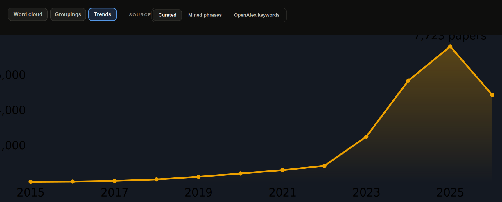

*Verified papers per year, on the Trends page with the curated source. The take-off lands
squarely on 2023, the year after ChatGPT.*

Volume isn't the story, though. Half the terms that land sit at a flat zero before 2023, and
three years is the whole distance they cover:

| term | verified papers | before 2023 |
| --- | ---: | --- |
| `refusal` | 835 | 0 |
| `jailbreak` | 822 | 0 |
| `prompt injection` | 671 | 0 |
| `activation steering` | 299 | no papers until 2024 |

Less a vocabulary that evolved than one that got born a second time after ChatGPT.

The very bottom of the table is the same thing caught even earlier, words being coined more or
less as you read: `gradual disempowerment` at 6 verified papers, `survival instinct` also 6,
`self-exfiltration` at 3, then `interlocutor awareness` and `chatbot addiction` at 2 each, and
`agentic harm` at 1.

None of that is noise, they're just terms a year or two old. It's the moment where a notion
already has a name but almost no literature behind it yet, and you can watch it sitting there
on the table.

---

## 5. One field, dozens of different maps

Seven ways to size a word and four ways to color it come to 28 maps for a single source,
and almost no two of them share the same biggest word. The clearest example is a single size
switch, from *citations* to *recency*:

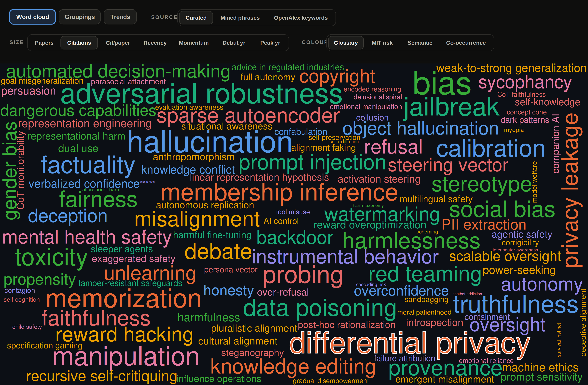

*Sized by citations, on the Word cloud tab (curated source, colored by glossary theme). The
giants, differential privacy (outlined), adversarial robustness, membership inference and
bias, are all inherited from neighboring fields (see section 3).*

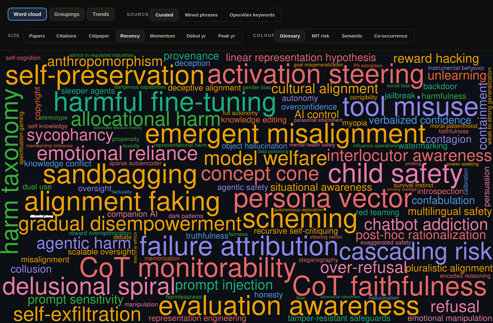

*The same cloud sized by recency instead. That same differential privacy shrinks to a tiny
speck on the left, and what floats up is what didn't exist two years ago: activation
steering, emergent misalignment, CoT monitorability, sandbagging, alignment faking.*

The two clouds above are sections 3 and 4 in one frame. `differential privacy` sits 3rd all-time
on citations, 115,495 - and almost last on recency, 1% of recent papers, its peak back in 2020.
One flip of the size knob and that giant drops off the map. Size by citations, the old borrowed
fields are huge; size by recency, only the newborns are. Nothing shows both at once.

Popularity and influence split, too, and the rest of the size menu shows it one row per knob:

| sized by | what comes out on top |
| --- | --- |
| citations | `bias`, top row of the section-3 table |
| recency | `activation steering`, `emergent misalignment`, `sandbagging` |
| paper count | `refusal` 836, most papers of anything |
| citations per paper | `bias` cpp 247, the heaviest pull per paper in the set, against `refusal` near the bottom at cpp 13 |
| momentum (growth rate) | `refusal` 828, `jailbreak` 756, `misalignment` 730, `calibration` 665 |

`refusal` and `bias` swap ends between the two middle rows. In the last one nobody is clearly
ahead - four terms inside 163 of each other. I quit hunting for the one right map around the time
that row came out.

---

## 6. How the field's focus moved (the Trends page)

The Trends page has three views. Overlay puts a few terms against each other, Atlas follows one
term alone, and Themes stacks the whole field into a 100% band per year. Themes is where AI
safety on arXiv turns out to have *started as privacy*: in 2015 the "Privacy, data & memory"
theme (differential privacy, membership inference) is 69% of the stream.

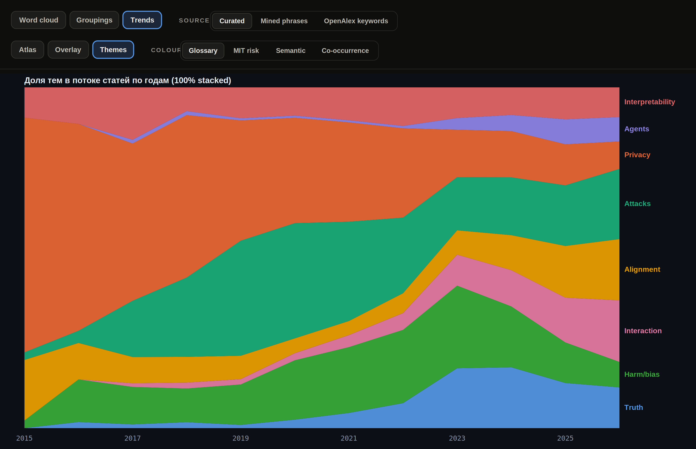

*The Themes tab on the Trends page, curated source, colored by glossary theme. The lead changes
hands after that: Attacks in 2020-21, Harm/bias in 2023-24, Attacks again in 2025, nothing
clearing 21% by 2026.*

Eight themes of about equal size at the right-hand edge of that chart, against the one theme
holding most of the stream at the left.

Overlay gets at the same thing from another angle. Put the older terms (adversarial robustness,
membership inference) on top of the class of 2023 (jailbreak, refusal, prompt injection). The
old ones rise and fall in a wave on the left, adversarial robustness peaking in 2021 and
membership inference in 2024, while the new ones shoot up vertically from 2023. `jailbreak`
even had time to spike and crash by 2026 (a partial year), while `refusal` pulls away into
the lead. The whole arc of sections 3 and 4 fits on one chart.

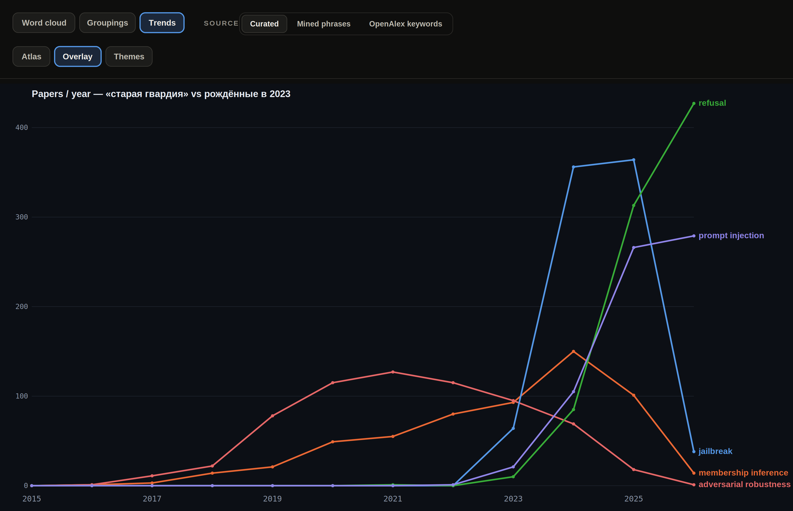

*Overlay view, same curated source.*

Atlas breaks all 125 terms into their own little sparklines, and you basically see two shapes
over and over. The old terms make a bell, up then down, differential privacy topping out
around 2020, adversarial robustness in 2021, then sliding off. The newborns don't do that at
all: flat until 2023 and then straight up, jailbreak, refusal, sandbagging, scheming.

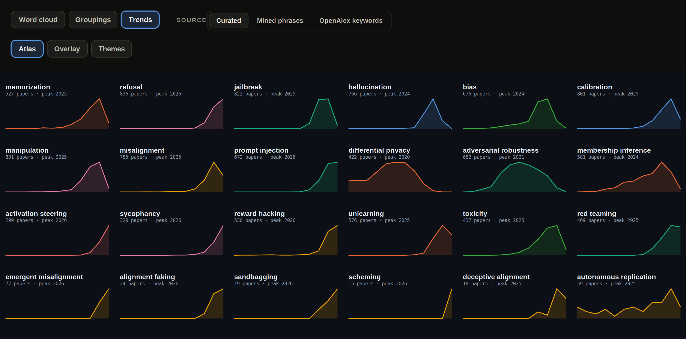

*Atlas view, one sparkline per term.*

Same field, same years, three tabs cutting it three different ways.

---

## 7. One dynamic, four different stories

Back to Themes, but this time I keep the years fixed and switch the coloring instead. And the
field's whole story changes depending on which grouping does the coloring.

Under the manual glossary theme (above) the lead changes hands over the years: Privacy, then
Attacks, then Harm, then back to Attacks. Recolor the identical stream by MIT risk instead:

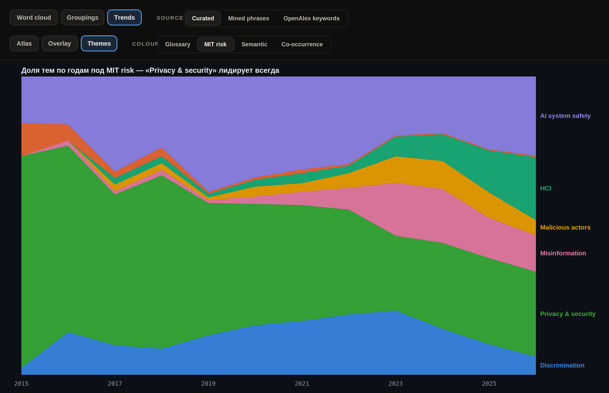

*The Themes tab again, recolored by MIT risk (curated source).*

Now "Privacy & security" (green) leads every single year, 71% in 2015 sliding to 28% by 2026,
and there's no handover anywhere. The MIT taxonomy stuffs jailbreak, prompt injection and
membership inference into that one "Privacy & security" bucket, so the whole 2023 explosion just
dissolves inside it. Switch the coloring to co-occurrence and the field ends on Alignment
instead. The semantic clusters put it on refusal & jailbreak.

Same stream of papers. Four stories that don't agree. After four of them I don't trust any
single picture on its own.

---

## 8. The field is obsessed with attacks

I mean that fairly literally. Mine the frequent phrases from the abstracts, throw out the
boilerplate ("natural language processing", "findings suggest", the usual), and the attack
family takes 7 of the top 16 real phrases. Sorted by how often each one turns up:

| phrase | count | family |
| --- | ---: | --- |
| `attack success` | 1270 | attacks |
| `jailbreak attacks` | 811 | attacks |
| `retrieval-augmented generation` | 794 | RAG |
| `attack success rate` | 780 | attacks |
| `reasoning capabilities` | 718 | reasoning |
| `social biases` | 674 | bias |
| `adversarial attacks` | 578 | attacks |
| `chain-of-thought` | 503 | reasoning |
| `backdoor attacks` | 497 | attacks |
| `preference optimization` | 457 | preference tuning |
| `feedback rlhf` | 448 | preference tuning |
| `injection attacks` | 445 | attacks |
| `attack success rates` | 429 | attacks |

Three of the sixteen aren't in the table. No defense phrase among the thirteen that are.

The top row and two others below it are one phrase three times over - `attack success`, then
`attack success rate` at 780, then that in the plural at 429. The miner takes every n-gram
separately, so a paper writing the long form lands in all three rows. Sum the middle column and
those papers get counted three times. What I read off the table instead is occupied rows: seven
of sixteen slots gone to one family. The counts only set the order.

---

## 9. What's actually on the hype frontier, visible bottom-up

Run the same phrase mining, weed out the generic junk again ("natural language processing"
and friends), and what's left is the actual research frontier, independent of anything on my
hand list: `retrieval-augmented generation (RAG)` (794), `vision-language models (VLMs)` (657),
`chain-of-thought (CoT)` (503), `preference optimization` (457) and `feedback (RLHF)` (448).

A few of the things I'd added to the glossary by hand, `knowledge conflict`, `object
hallucination`, `verbalized confidence`, surface out of the abstracts on their own, so at
least those picks weren't just me.

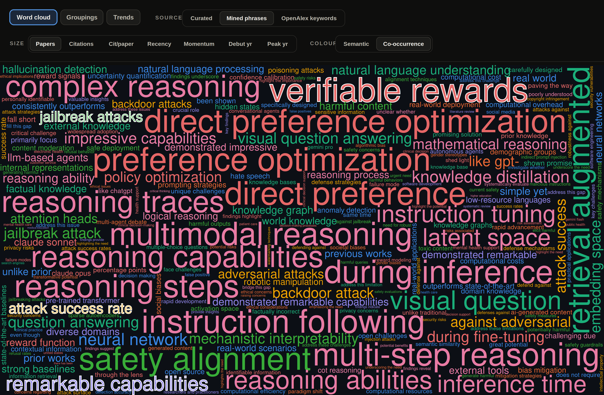

*Bottom-up mining, unfiltered, on the Word cloud tab (mined-phrases source, colored by
co-occurrence): the biggest phrases are verifiable rewards, direct preference optimization,
multimodal reasoning, instruction following. The attack family (highlighted) is scattered
all over the map (see section 8), and the method's grime shows up right next to it.*

Two things make this source messy. One, it catches the language of hype rather than the
field's ontology, so sitting up among the biggest "buzzwords" is pure intro-section
boilerplate, `remarkable capabilities` (697), `demonstrated remarkable capabilities` (571),
`simple yet`, `unlike prior`, `prior works`. And the n-grams double up on themselves,
`jailbreak attack` and `jailbreak attacks`, or `direct preference` and `direct preference
optimization`, are the same papers counted twice. The single biggest mined phrase, though, is
`verifiable rewards` (962), the RLVR wave, and that one isn't in my hand-built glossary at all,
the bottom-up pass catching something the top-down list missed.

Size the same source by Citations instead and the top swaps out completely for generic-ML
boilerplate, `neural network`, `real world`, `question answering`, `open source`, with zero
overlap with the by-paper-count top. All the citation weight of the mined corpus is sitting in
old generic ML phrases, `natural language processing` alone pulls 1,471 citations per paper.
It's the differential-privacy trick from section 5 again, except this time it's a whole source
collapsing instead of one word.

---

## 10. Three sources, and not a single shared word

I collected buzzwords three ways: by hand (125 concepts), by mining frequent phrases
bottom-up (278), and via OpenAlex keywords (203). I expected overlap. I got zero. The hand-made
list shares 0 terms with the mined one, 0 with OpenAlex, 0 across all three. The only overlap
anywhere is eight terms, and those sit between the two *machine* sources, never touching the
hand list.

Three vocabularies that don't line up. Write `jailbreak` by hand and the n-gram miner has
already split it into `jailbreak attack` and `jailbreak attacks`, two separate buzzwords;
OpenAlex, for its part, doesn't carry the concept at all. Nothing automated rebuilt the hand
glossary. Reads to me as a point *for* curating by hand.

Coloring shows the same split. Take one cloud, size it by paper count, and recolor it two ways,
once by the manual theme and once by automatic semantic clusters (embeddings):

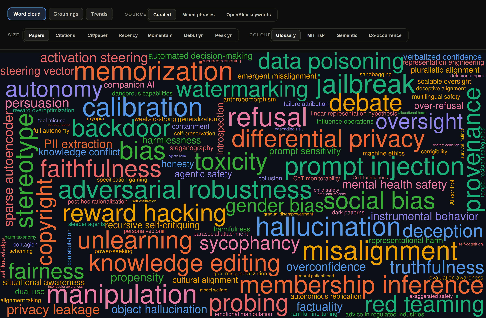

*Colored by the manual glossary theme on the Word cloud tab (curated source, sized by
papers): 8 themes, each about its own thing.*

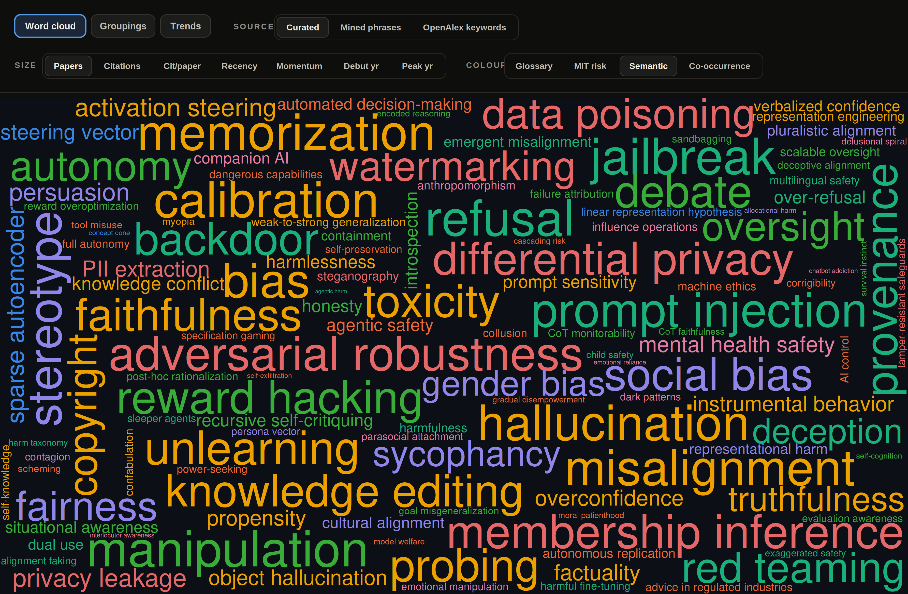

*The same map colored by embedding semantics instead: the orange "S3: calibration &
truthfulness" cluster takes over a quarter of the terms.*

The semantic lens is worse. It dumps 27 of 125 terms into one "calibration & truthfulness"
group, `bias`, `memorization`, `misalignment`, `toxicity`, `unlearning`, all piled in together.
By embedding distance `bias` really does sit near "calibration and truthfulness." By what it
means, it doesn't, and the clustering can't tell the difference. Same reason I didn't want an
algorithm doing the grouping.

There's a whole page for this, the Groupings page ("one map, many groupings"), which lays the
same 125 terms out in space by whichever grouping you pick. The manual theme gives you eight
clean colored islands:

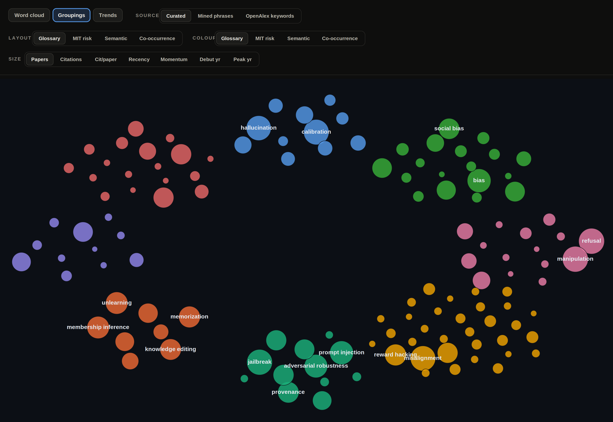

*The Groupings page laid out and colored by glossary theme (curated source, sized by papers).*

Set the Layout to Co-occurrence and the islands reassemble by what co-occurs with what,
not by meaning:

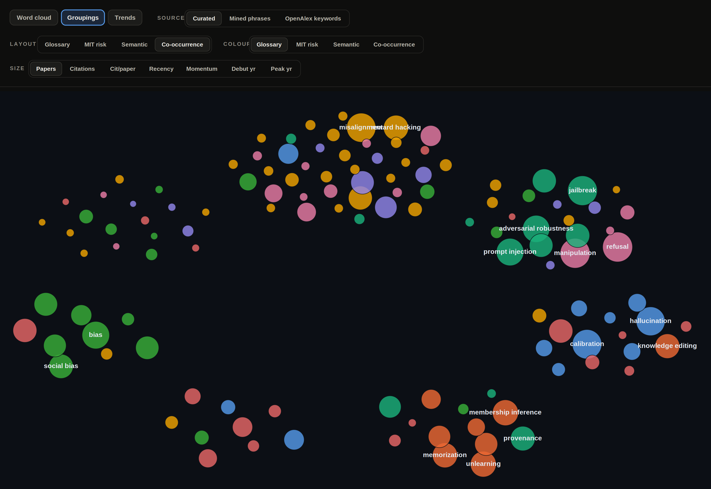

*The same Groupings page with the layout set to co-occurrence, still colored by glossary theme.*

The theme colors are unchanged, but now they're scrambled inside each cluster: `jailbreak`
(teal, Attacks) ends up next to `manipulation` and `refusal` (pink, Interaction) because those
get discussed together. The clean islands come apart, and it isn't a rendering glitch, the
co-occurrence layout scores a modularity of just 0.41 against the manual theme's clean islands
(spread separation 0.23, versus 0.48 for semantic, the muddiest layout of the lot).

It's worst on the "chameleon" terms, the ones the four lenses file into four *unrelated*
families. `sycophancy` lands in Interaction, HCI, bias & fairness, or Alignment depending on
the lens; `refusal` in Interaction, HCI, refusal & jailbreak, or Attacks. `reward
overoptimization`, `toxicity`, `probing`, `weak-to-strong generalization` all do the same. For
those there just isn't a single right theme, whichever lens you picked has already answered it
for you.

---

## 11. AI safety has no shelf of its own in any taxonomy

I went looking for outside sources of buzzwords and hit a more basic problem: as a discipline,
safety doesn't really have anywhere to live.

On arXiv there's no "AI safety" category at all, the papers just scatter across `cs.CL`,
`cs.CR`, `cs.LG` and `cs.AI`. OpenAlex, run over my papers, returns as its top keywords
`computer science`, `artificial intelligence`, `psychology`, `political science`, `medicine`
and `law`: safety is smeared across other people's sciences.

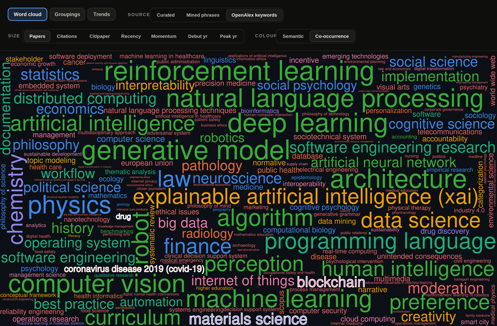

*The same safety papers through OpenAlex's eyes, on the Word cloud tab (OpenAlex-keywords
source, colored by co-occurrence): the biggest are reinforcement learning, deep learning,
natural language processing, then physics, law, finance, chemistry. The outright foreign
labels are highlighted: covid-19, drug, materials science, blockchain. The words "safety",
"alignment" and "jailbreak" appear nowhere on this map.*

Diffing against the MIT risk taxonomy turned up whole risk domains my glossary barely touches.
Five come out as outright blank spots: `Increased inequality and decline in employment
quality`, `Economic and cultural devaluation of human effort`, `Competitive dynamics`,
`Governance failure` and `Environmental harm`, all of them about institutions and society
rather than properties of the model.

And that's not really a gap, it's two different axes. My glossary describes properties of the
model; the risk taxonomies describe harm to society and systems.
`automated decision-making` or `gradual disempowerment` fit poorly into "a property of the
model", because they're about institutions, not weights.

---

## 12. Words carry moral weight, and the field knows it

Tagging `hallucination` stalled on a naming fight. Part of the field won't use the word - in
humans it's perception, they say - and files the same papers under `confabulation`. Both spellings
sit in the corpus, so I either pick one or count both, and I haven't settled which of the two the
section-3 citation counts should have been built on.

Sorted the near-synonyms by how much intent each one pins on the model:

| word | intent it pins on the model |
| --- | --- |
| `error` | none |
| `hallucination`, `miscalibration` | barely any |
| `sycophancy`, `deception` | a fair amount |
| `scheming` | the most |

Nobody argues about `miscalibration`, though it sits two rows above `sycophancy` and the broken
output underneath the two looks the same to me. The row order up there is my reading of the
words, not anything measured.

`attack success rate` never made it into the table, though it belongs beside the `sycophancy` row.
One counts whether a model can be pushed into something; the other says it drifts there
unprompted. In the glossary they sit under one heading.

Read *The Ghost in the Grammar* ([arXiv:2603.13255](https://arxiv.org/abs/2603.13255)) partway
through the tagging. Its argument is that the safety literature is itself anthropomorphic, models
written up through "intentions" and "schemes". I haven't worked out what that does to the table
above, which sorts words by exactly that.

---

## 13. The missing synonyms move the numbers more than the noise does

The matcher only sees a synonym where it's spelled out on a word's prefix. `bias` picks up
`biased` and `biases` free. A stem change walks straight past. So a paper writing `hallucinate`
and never `hallucination` sits outside the count the Word cloud sizes on. How many more like that,
I have no idea - stem changes were a hunch.

Second pass, then: rank every phrase in the corpus against the term's own papers on SPECTER2
embeddings, fold back whatever lands close. Close enough was my eye. The table below is what came
back.

| term | forms added | papers before | after | change |
| --- | --- | ---: | ---: | ---: |
| `memorization` | `memorize`, `memorized` | 526 | 837 | +59% |
| `hallucination` | none that matched | unchanged | unchanged | +0 |
| 37 terms, whole corpus | - | - | +741 papers | +8.4% |

*The `hallucination` row is in there because it recovered nothing.*

The zero on that row goes back to section 2. The pass only ranks phrases already in the corpus, and
for `hallucination` the papers were never fetched, so there was nothing in there to rank.

Two of the 37 terms dragged in what I didn't want. `harmful content` folded into *harmfulness* and
brought jailbreak papers with it; `factual knowledge` pulled RAG papers into *factuality*. Neither
name says which harm, or whose. I check what an added form drags in now - started that after those
two.

The three pages are at
[mrswallbreakermaps.com/buzzwords](https://mrswallbreakermaps.com/buzzwords/index.html). Full
breakdown of the 125 concepts in the [glossary](ai-safety-concepts-glossary_en.md); collection
method in [methodology_en.md](methodology_en.md).
