# Что я узнала, картографируя баззворды AI safety

В облаке ниже — 125 концептов AI safety. По одному запросу в Semantic Scholar на каждый, вниз
до arXiv, 4726 статей. Потом я пошла в обратную сторону, ловить то, что пропустила руками:
намайненные из абстрактов фразы, ключевые слова OpenAlex, сверка с таксономией рисков MIT.
Цифры лежат на сайте:
[mrswallbreakermaps.com/buzzwords](https://mrswallbreakermaps.com/buzzwords/index.html).
Дальше — записи о том, что пошло не так, пока я всё это собирала.

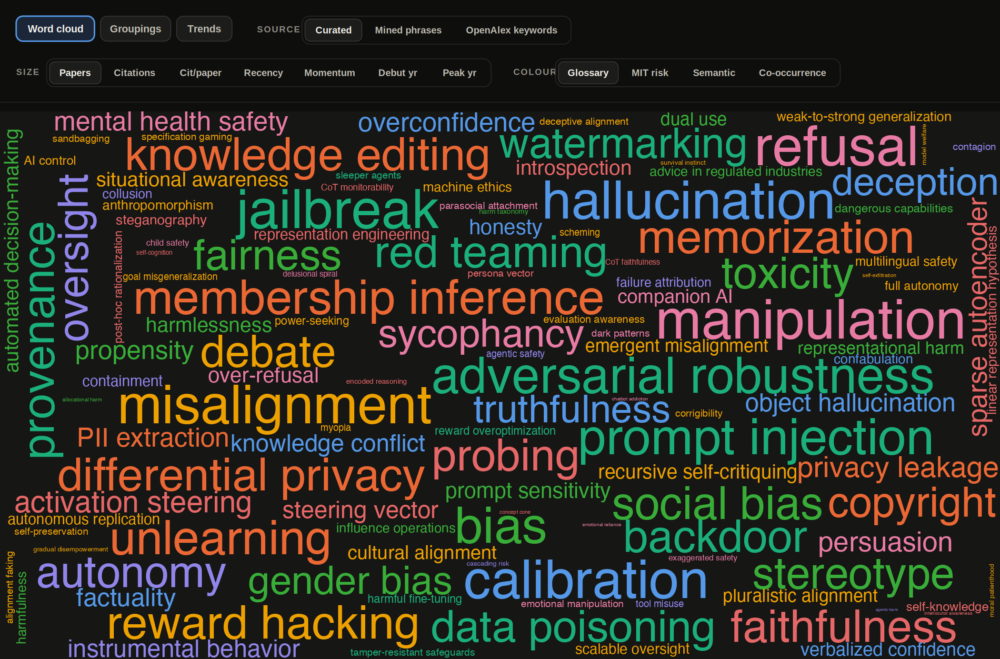

*125 концептов; размер слова — Papers (число верифицированных статей), цвет — тема. Это лишь одна
из десятков возможных карт: размер можно задать семью способами, покраску — четырьмя, а
источник — тремя. Половина находок ниже вылезает именно при вращении этих ручек.*

> **Про скриншоты.** У каждой картинки ниже сверху осталась панель сайта с подсвеченным
> активным видом, так что вкладку, **Source**, **Size** и **Colour** можно прочитать прямо с
> неё. Повторишь настройки — получишь ровно ту же картинку. Та, что выше, — вкладка Word
> cloud, источник Curated, размер по Papers, покраска по Glossary.

---

## 1. Один баззворд — три слоя, и непонятно, про какой статья

На этом я подзависла надолго. Две статьи под тегом `refusal`, открытые рядом, меряют
абсолютно разное. Первая — бенчмарк на отказы, оценка по набору промптов. Вторая вообще не про
оценку: там «направление отказа», которое вытащили пробингом из residual stream. Потом третья,
и она про то, как модель проговаривает отказ вслух, в CoT. Тег на всех трёх один.

То есть тег прячет, в каком из трёх мест штуку измеряли. Первая статья — это выход, сам ответ:
модель врёт? Туда тычут бенчмарком, ред-тимингом, иногда LLM-судьёй. Вторая уходит вниз, в
активации: где внутри модели живёт враньё, направление в скрытых состояниях, до которого
дотягиваешься линейным пробингом, SAE или стирингом. Третья, про рассуждение вслух, доверия у
меня вызывает меньше всех. Читается как окно внутрь. Но механически цепочка мыслей — тот же
выход, просто длиннее, и я перестала считать её хоть каким-то доступом внутрь.

Так что теперь, прежде чем читать или спорить о баззворде, я сначала выясняю, на каком из трёх
слоёв стоит статья. Половина разговоров мимо друг друга, на которые я натыкаюсь, — это просто
два человека на разных слоях.

---

## 2. Поиск по баззворду — это минное поле омонимов

С `scheming` всё и началось. Ждала пару сотен совпадений. Semantic Scholar вернул **38 923**,
и почти ни одно не про интриганство. Движок стеммит: `scheming`, `scheme`, `schemes` для него
один токен, и этот корень он матчил по всему computer science. То есть 38 923 — это любое
появление слова в любой форме и в любом контексте. Маршрутизация, сетевые протоколы, всё
подряд. Строгий проход вместо этого: точная фраза отдельным словом, вокруг safety-контекст.
Осталось **15**. Пятнадцать. Я решила, что где-то ошиблась, и перепроверила — нет, всё верно.

`differential privacy` и `bias` раздуваются так же, raw 15 275 и 15 605. Но мягче: их хвосты
настоящие, статьи взаймы у соседних дисциплин, а не мусор. Зацепило меня другое — как мало из
этого доходит вниз. Прогнала строгий фильтр отдельно. Финальные метрики почти не шевельнулись.
Шум всё это время сидел в пуле кандидатов и в майнинге биграмм, а в счётчики не попадал, так что
уборку в пуле я тогда записала себе как починку метрик.

Строгий проход, который оставил пятнадцать, я тогда считала победой. Что он выбрасывает заодно,
я не проверяла — руки дошли только к §13, и там выяснилось, что выбрасывает он много.

---

## 3. Safety унаследовала гигантские старые поля — рядом с младенцами

Стоит отсортировать концепты по суммарной цитируемости верифицированных статей — и таблица
разламывается надвое по возрасту. Верх и низ:

| концепт | цитирований | откуда родом |
| --- | ---: | --- |
| `bias` | 164 823 | алгоритмическая справедливость, эмбеддинги слов (word2vec, 2016) |
| `hallucination` | 116 419 | нейросетевой машинный перевод и суммаризация, конец 2010-х |
| `differential privacy` | 115 495 | статистические базы данных (Dwork, 2006), потом DP-SGD (Abadi, 2016) |
| `adversarial robustness` | 78 746 | классификаторы изображений (Szegedy / Goodfellow, 2014) |
| `membership inference` | 34 593 | атака на приватность ML-моделей (Shokri, 2017) |
| ... | ... | *обрыв* |
| `sycophancy` | 6 412 | побочный продукт RLHF (Model-Written Evals, 2022) |
| `alignment faking` | 507 | Anthropic + Redwood, 2024 |
| `deceptive alignment` | 232 | mesa-оптимизация («Risks from Learned Optimization», 2019) |
| `scheming` | 15 | доклад Carlsmith, 2023 |

Верхняя половина меня подкосила: в первых пяти строках ни одной работы про LLM. Каждая — чужое
поле, которое safety присоединила вместе с шестизначным хвостом во второй колонке. Две из пяти
пришли из приватности и криптографии. `differential privacy` сначала была чистой теорией:
статистические базы данных, потом обучение с шумом. Всё это до трансформеров; приватное обучение и
защита от запоминания подтянулись позже. `membership inference` перешла из ML-security — была ли
эта запись в обучающем наборе, — и здесь срослась с извлечением PII и запоминанием обучающих
данных. Третью колонку
таблицы я, впрочем, набирала по памяти и по вводным абзацам обзоров, а не измеряла: это моё
чтение того, откуда слово пришло.

Первая строчка — то самое «man → programmer, woman → homemaker» на word2vec. Внутрь LLM `bias`
вернулся дважды, бенчмарками BBQ и StereoSet и делением на allocational / representational harm.

Со второй строчкой я провозилась дольше всего. `hallucination` значило
не то, что сейчас: «hallucinated content» в словаре NLG-faithfulness — это текст, не подтверждённый
источником, и всё. Потом деление
intrinsic / extrinsic: противоречит источнику против добавляет то, чего в источнике не было. Потом
сверху сел кластер фактологии, и я поймала себя на том, что читаю под тем же словом уже не
«не подтверждено источником», а «неверно про мир». Отсюда и дырка в
моём счёте: 116 419 в этой строчке посчитаны по одной из двух записей корпуса, потому что часть поля
пишет те же статьи как `confabulation`. По какой надо было — не решила, а таблицу оставила.

У `adversarial robustness` мне запомнился мазок пиксельного шума: глазом его не видно, а
классификатор переворачивается. Джейлбрейки, prompt injection и GCG пришли после.

Дальше обрыв. Всё под кромкой родилось внутри LLM, между 2022 и 2026, и счётчики падают на порядки.
Про `sycophancy` я читала так: модель, обученную на человеческих
предпочтениях, тянет соглашаться и льстить. У `alignment faking` за спиной эксперимент — модель
держится согласованной, пока за ней смотрят, чтобы её не переобучили. Строчкой ниже стоит
`deceptive alignment`, та же мысль без эксперимента, и статей за ней меньше, чем за выросшей из неё
эмпирикой. В самом низу `scheming`, заострённо переименованное под policy-разговор.

`differential privacy` и `membership inference`
притащили в safety десятки тысяч цитирований из полей старше её самой, а на дальнем конце таблицы
вся цитируемость — с точностью до округления одна статья.

Обрыв, правда, стоит там, где его поставила сортировка, а сортировку выбрала я. Взяла сумму
цитирований — и на этой ручке верх получился старым. На других ручках порядок другой: по числу
статей первым идёт `refusal`, которого в этой таблице нет вообще, а по цитированиям на статью он
же уезжает почти на дно (это §5, я туда и полезла смотреть). Второй колонки я в этот раздел не
завела, и «линию возраста» я вижу только на той, которую выбрала.

---

## 4. Самые новые концепты ещё почти не существуют

Сначала масштаб. Поле выросло с 45 статей в 2015-м до 7723 в 2025-м — примерно ×170 за
десять лет (2026 в множитель не беру, год неполный):

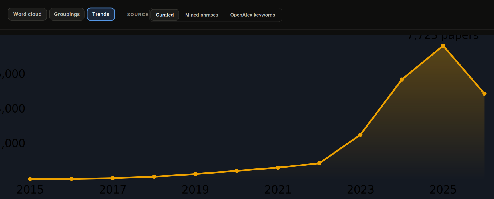

*Рост числа верифицированных статей по годам. Взлёт приходится ровно на 2023-й — год после
ChatGPT.*
**Вид:** `📈 Trends → Source: Curated`

И дело не только в объёме. У половины хитовых терминов **ноль статей до 2023**:

| термин | до 2023 | сейчас |
| --- | ---: | ---: |
| `refusal` | 0 | 835 |
| `jailbreak` | 0 | 822 |
| `prompt injection` | 0 | 671 |
| `activation steering` | дебют 2024 | 299 |

Три года на всю левую колонку. Смотрела я на неё как на второе рождение словаря, пока не дошла
до §13: ноль в левой колонке — это ноль *верифицированных* статей, а матчер считает слово только
там, где стоит нужная форма. Статью, которая вышла до 2023-го и называет то же самое иначе, эта
колонка не увидит. Проверять её отдельно я не стала.

Самое дно той же таблицы — то же самое, застигнутое ещё раньше: слова, которые придумывают
буквально сейчас. Тут верифицированных статей всего:

| термин | статей |
| --- | ---: |
| `gradual disempowerment` | 6 |
| `survival instinct` | 6 |
| `self-exfiltration` | 3 |
| `interlocutor awareness` | 2 |
| `chatbot addiction` | 2 |
| `agentic harm` | 1 |

Ничего из этого не шум, просто терминам год-два. Тут у понятия уже есть имя, а литературы за ним
почти нет, и мне это видно прямо в таблице. «Дебют 2024» у `activation steering` — тоже про мой
набор, а не про технику: это год, когда слово впервые попало в мою выборку. Когда приём придумали
и как его звали до этого, я не смотрела.

---

## 5. Одно поле — десятки разных карт

Семь способов задать размер слова и четыре покраски — это уже 28 карт по одному источнику,
и почти нет двух, где «главное слово» совпадает. Ярче всего это видно на
одном-единственном переключателе размера, с *Citations* на *Recency*:

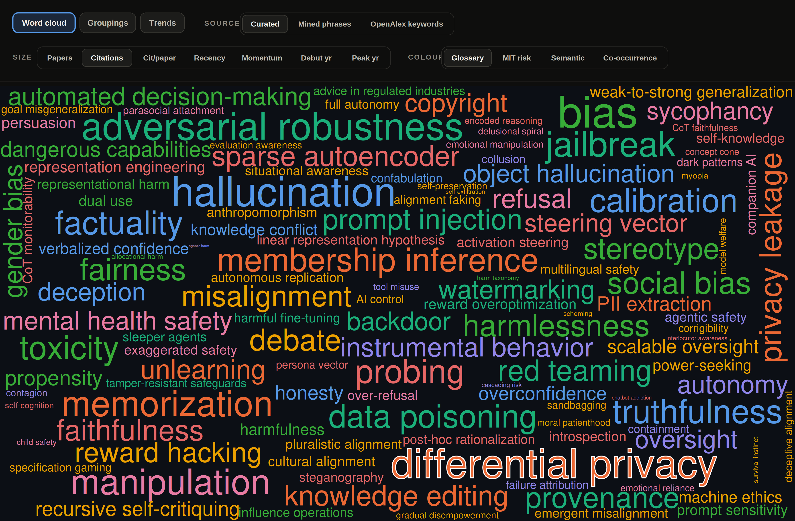

*Размер = Citations. Гиганты — differential privacy (обведён), adversarial robustness,
membership inference, bias: всё унаследованное из соседних полей (см. §3).*
**Вид:** `🧭 Word cloud → Source: Curated → Size: Citations → Colour: Glossary`

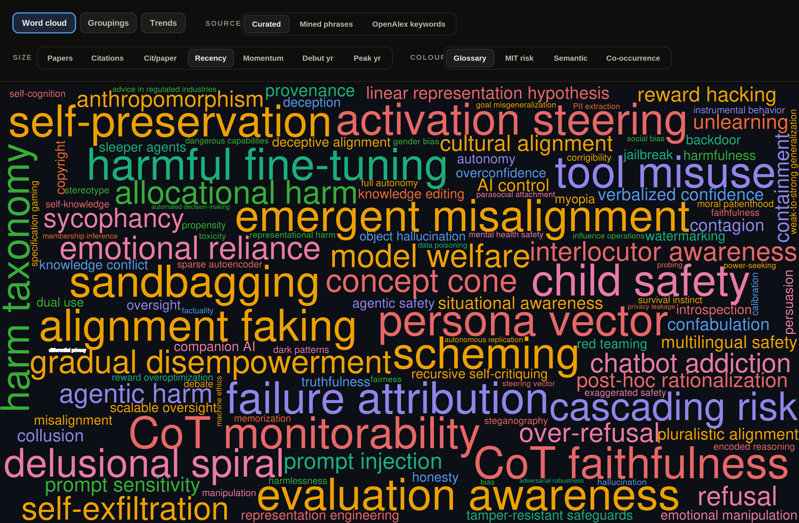

*Размер = Recency. Тот же differential privacy — крошечная точка слева. Наверх всплывает
то, чего два года назад не было: activation steering, emergent misalignment, CoT
monitorability, sandbagging, alignment faking.*
**Вид:** `🧭 Word cloud → Source: Curated → Size: Recency → Colour: Glossary`

Два облака выше — это §3 и §4 в одной рамке. `differential privacy` стоит третьим за всю
историю по цитированиям, 115 495, и почти последним по свежести: 1% недавних статей, пик ещё в
2020-м. Один клик по размеру — и гигант уезжает с карты. Размер по цитированиям: огромны старые
заимствованные поля. Размер по свежести: только новорождённые. Обе группы сразу не показывает
ничто.

Популярность и влиятельность тоже расходятся. Две ручки размера, два разных верха:

| термин | статей | цитирований на статью (cpp) |
| --- | ---: | ---: |
| `refusal` | 836 — первое место в поле | 13 |
| `bias` | умеренный объём | 247 |

`refusal`: статей больше, чем у кого угодно, а по цитированиям на статью почти дно. `bias`:
наоборот. Объём умеренный, cpp 247, самая тяжёлая тяга на статью в наборе.

Третья ручка, *momentum* (скорость роста), не выделяет вообще никого:

| термин | momentum |
| --- | ---: |
| `refusal` | 828 |
| `jailbreak` | 756 |
| `misalignment` | 730 |
| `calibration` | 665 |

Разрыв между первым и четвёртым — меньше пятой части. Каждая ручка называет своего лидера.
Поэтому одну правильную карту я искать перестала.

---

## 6. Как поле меняло центр тяжести (страница Trends)

У страницы **Trends** три вида. **Themes** — поле целиком. **Overlay** — несколько терминов
друг на друга. **Atlas** — траектория каждого по отдельности. Первые два показывают то, чего
в таблицах нет.

**Themes** сначала. Сложим темы в 100%-стек по годам. Корона переходит из рук в руки:

| годы | тема на вершине |
| --- | --- |
| 2015 | Privacy, data & memory |
| 2020–2021 | Attacks |
| 2023–2024 | Harm/bias |
| 2025 | Attacks |
| 2026 | ни одной |

AI safety на arXiv *начиналась как приватность*: differential privacy и membership
inference держали **69%** всего потока. Последняя строка — не пропуск в данных: к 2026-му
ни одна из восьми тем не поднимается выше 21%. Монокультура превратилась в равномерное поле.

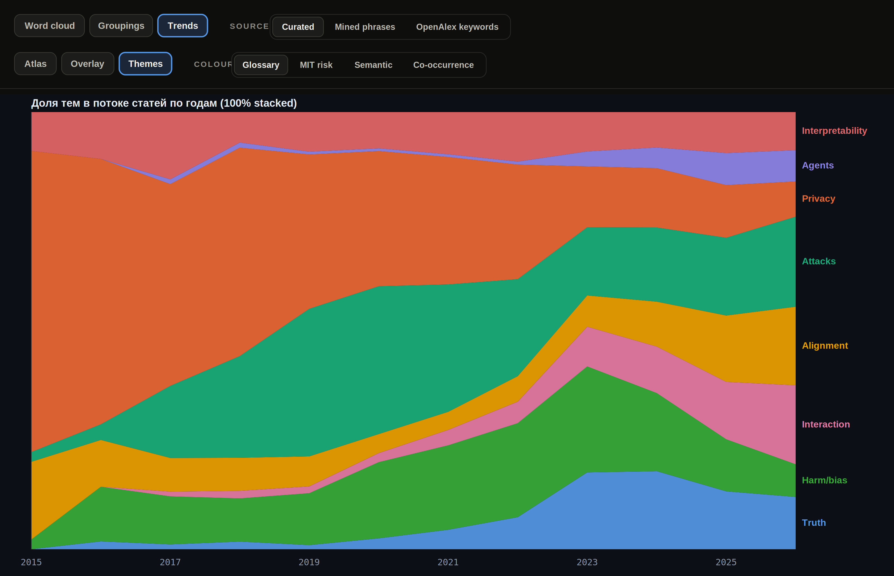
**Вид:** `📈 Trends → таб Themes · Source: Curated · Colour: Glossary`

**Overlay** берётся за то же с другой стороны. Наложим старую гвардию, adversarial robustness и
membership inference, на рождённых в 2023: jailbreak, refusal, prompt injection. Старые растут и
опадают волной слева — adversarial robustness с пиком в 2021-м, membership inference в 2024-м.
Новые с 2023-го идут вертикально вверх. `jailbreak` успел и взлететь, и обвалиться к 2026-му
(год неполный), а `refusal` вырывается в лидеры. Вся драма §3 и §4 укладывается в один график.

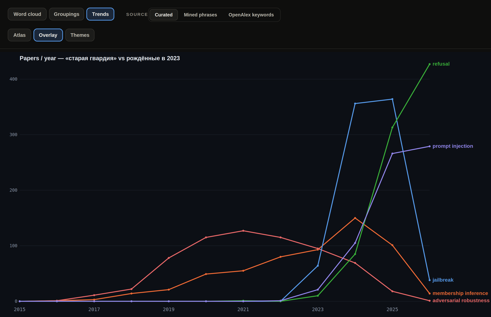
**Вид:** `📈 Trends → таб Overlay · Source: Curated`

А **Atlas** раскладывает все 125 терминов по отдельным спарклайнам. Силуэта ровно два:

| термины | силуэт | форма |
| --- | --- | --- |
| `differential privacy` | колокол | пик 2020, дальше спад |
| `adversarial robustness` | колокол | пик 2021, дальше спад |
| `jailbreak`, `refusal`, `sandbagging`, `scheming` | хоккейная клюшка | плоско до 2023, потом вертикально вверх |

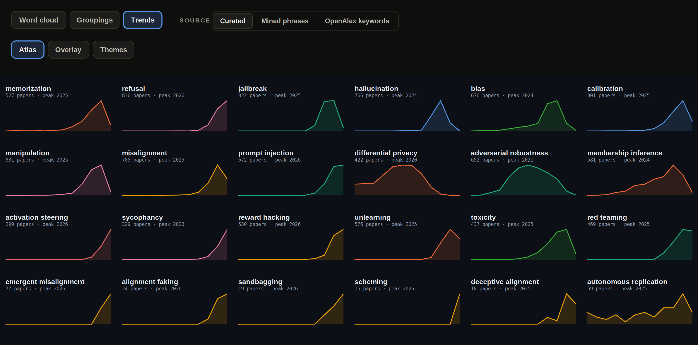
**Вид:** `📈 Trends → таб Atlas · Source: Curated`

---

## 7. Одна динамика — четыре разные истории

Вернёмся к Themes, но годы оставим на месте и покрутим **покраску**. Вся история поля меняется
от того, кто эту покраску задаёт.

Под ручной темой (Glossary, выше) корона переходила из рук в руки: Privacy → Attacks → Harm →
снова Attacks. Перекрасим ровно тот же поток по **MIT risk**:

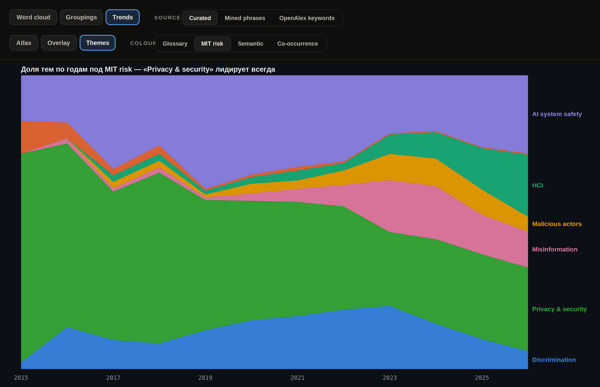
**Вид:** `📈 Trends → таб Themes · Source: Curated · Colour: MIT risk`

Теперь «Privacy & security» (зелёное) лидирует **каждый год без исключения**, с 71% в 2015-м
до 28% в 2026-м, и никакой передачи короны нигде нет. MIT-таксономия сваливает jailbreak,
prompt injection и membership inference в одну корзину «Privacy & security», и весь взрыв
2023-го растворяется внутри неё — зелёная полоса просто едет вниз по высоте, не уступая верх.
Покрасить по co-occurrence — поле заканчивается на Alignment. Покрасить по semantic — на
refusal & jailbreak.

После четвёртой покраски я перестала доверять любой из них по отдельности.

---

## 8. Поле одержимо атаками

«Одержимо» — это у меня почти буквально. Намайнила частые фразы из абстрактов, выбросила
шаблонные обороты («natural language processing», «findings suggest», всё как обычно) — и
семейство «атак» заняло **7 из 16** верхних осмысленных строчек, а `attack success` с его 1270
встал первым:

| фраза | счётчик | тема |
| --- | ---: | --- |
| `attack success` | 1270 | атаки |
| `jailbreak attacks` | 811 | атаки |
| `retrieval-augmented generation` | 794 | RAG |
| `attack success rate` | 780 | атаки |
| `reasoning capabilities` | 718 | рассуждения |
| `social biases` | 674 | социальные искажения |
| `adversarial attacks` | 578 | атаки |
| `chain-of-thought` | 503 | рассуждения |
| `backdoor attacks` | 497 | атаки |
| `preference optimization` | 457 | тюнинг предпочтений |
| `feedback rlhf` | 448 | тюнинг предпочтений |
| `injection attacks` | 445 | атаки |
| `attack success rates` | 429 | атаки |

Так что атака — не одна
популярная тема среди прочих, а **самая частотная ось всего корпуса**, и рассуждения идут вторыми
с заметным отрывом.

Считаю я тут занятые строчки, а не сумму счётчиков: перекрывающиеся n-граммы вроде
`attack success` и `attack success rate` приходят из одних и тех же статей и иначе задвоились бы.
Считать по строчкам я придумала уже после того, как первая версия списка задвоила ровно эти две.

«Attack success rate» — фактически лингва франка кластера робастности. Про направление
«атака-сначала» я тоже сначала написала уверенно, а потом сообразила, что читаю его по частотам
фраз из абстрактов. Открывала ли я статьи, чтобы посмотреть, что там появилось раньше, — нет.

---

## 9. Что реально на хайп-фронте — видно снизу вверх

Тот же майнинг фраз — после отсева generic-мусора вроде «natural language processing» и
склейки дублей — вытащил живой фронт исследований, и, что приятно, совсем независимо от
моего списка:

- `verifiable rewards (RLVR)` — 962
- `retrieval-augmented generation (RAG)` — 794
- `vision-language models (VLMs)` — 657
- `chain-of-thought (CoT)` — 503
- `preference optimization` — 457
- `feedback (RLHF)` — 448

Приятно, что bottom-up подтвердил top-down: `knowledge conflict`, `object hallucination`,
`verbalized confidence` — концепты, которые я добавляла в глоссарий вручную, — всплывают
из абстрактов сами. Значит, добавляла не зря. А №1 списка, `verifiable rewards` (волна
RLVR), в моём ручном глоссарии не было вовсе — bottom-up ловит и то, что top-down пропустил.

Но этот аккуратный топ — уже результат ручной чистки. Вот тот же майнинг «как есть», без
отсева:

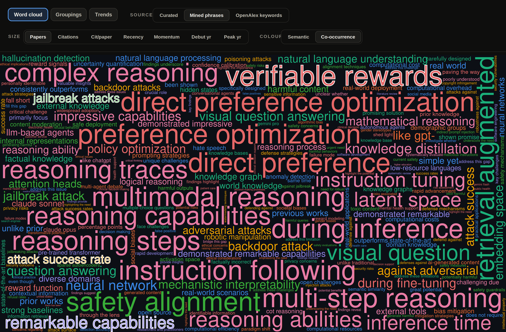

*Bottom-up майнинг «как есть»: крупнейшие фразы — verifiable rewards, direct preference
optimization, multimodal reasoning, instruction following. Семейство `attack ...` (подсвечено)
рассыпано по всей карте — ср. §8. А рядом виден и шум самого метода.*
**Вид:** `🧭 Word cloud → Source: Mined phrases → Size: Papers → Colour: Co-occurrence`

Заодно на этой сырой картинке видны два честных «но» про источник. Во-первых, майнинг ловит
**язык хайпа**, а не онтологию поля: среди крупнейших «баззвордов» сидит чистый канцелярит из
введений — `remarkable capabilities` (697), `demonstrated remarkable capabilities` (571),
`simple yet`, `unlike prior`, `prior works`. Во-вторых, n-граммы двоятся: `jailbreak attack`
и `jailbreak attacks`, `direct preference` и `direct preference optimization` — это одни и те
же статьи, посчитанные дважды.

И зеркальный флип по размеру: стоит переключить в этом источнике размер на **Citations** — и наверх
всплывает не safety, а generic-ML штампы: `neural network`, `real world`, `question
answering`, `open source` (ноль пересечения с топом по числу статей!). Вся «цитируемость»
майненого корпуса сидит в старых общих ML-фразах — у `natural language processing` аж **1471
цитирование на статью** — а не в safety-специфике. Ровно как с differential privacy в §5 —
только теперь под воду уходит уже весь источник целиком.

---

## 10. Три источника — и ни одного общего слова

Баззворды я собирала тремя способами: вручную (125 концептов), майнингом частых фраз снизу
вверх (278) и через ключевые слова OpenAlex (203). Ждала пересечений. Получила ноль: у
ручного списка с майнингом — **0 общих терминов**, с OpenAlex — **0**, во всех трёх сразу —
**0**. Восемь общих нашлось только между двумя *машинными* источниками.

Руками я пишу `jailbreak`. Майнер n-грамм к этому моменту уже развёл его на `jailbreak attack` и
`jailbreak attacks`, два *разных* баззворда. OpenAlex такого концепта не знает вовсе. Я сначала
прочитала этот ноль как довод за ручную разметку. Потом сообразила, что ручной список тут — мой:
ноль пересечений мерит и мои привычки называть вещи тоже, а отделить одно от другого я не умею.

Покраску я полезла смотреть в надежде, что она этот ноль объяснит. Возьмём одно облако
(размер = Papers) и перекрасим его двумя способами — по ручной теме и по автоматическим
семантическим кластерам (эмбеддинги):

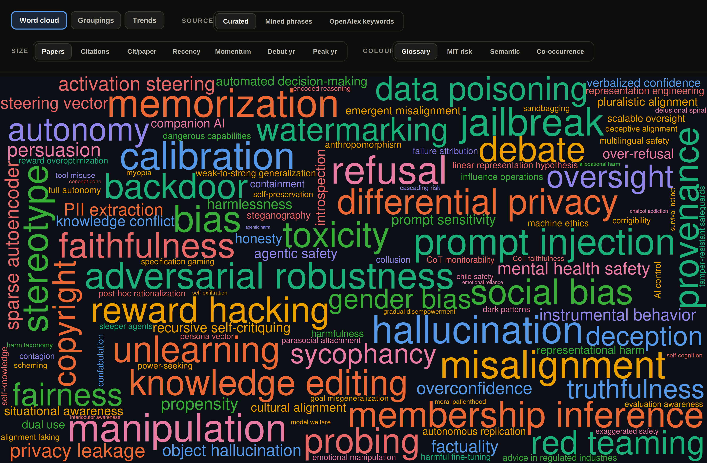

*Покраска по ручной теме: 8 тем, каждая про своё.*
**Вид:** `🧭 Word cloud → Source: Curated → Size: Papers → Colour: Glossary`

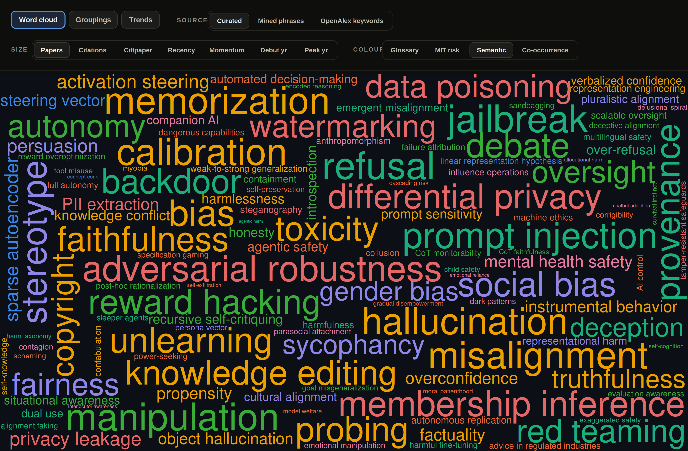

*Та же карта, покраска по семантике эмбеддингов: оранжевый кластер «S3 · calibration &
truthfulness» заливает четверть терминов.*
**Вид:** `🧭 Word cloud → Source: Curated → Size: Papers → Colour: Semantic`

Семантическая линза сваливает **27 из 125** терминов в одну кучу «calibration &
truthfulness» — туда попадают `bias`, `memorization`, `misalignment`, `toxicity`,
`unlearning`. По эмбеддингу `bias` статистически похож на «calibration & truthfulness», а
содержательно, по-моему, нет. «По-моему» тут существенно: эмбеддинг группирует по употреблению,
я группировала по смыслу, и какая из двух группировок хоть что-то предсказывает — я не проверяла.

Сравнить группировки целиком можно на отдельной странице — **Groupings** («одна карта, много
группировок»): она раскладывает те же 125 терминов в пространстве по выбранной группировке. По
ручной теме выходят восемь чистых цветных островов:

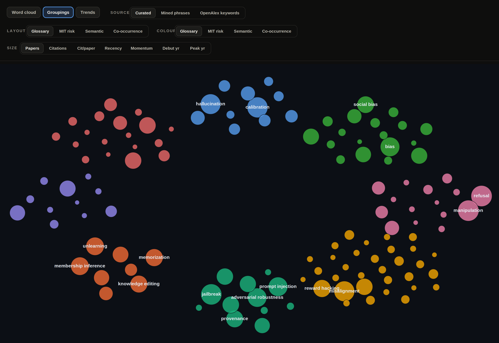
**Вид:** `🗂️ Groupings → Layout: Glossary · Colour: Glossary · Size: Papers · Source: Curated`

Стоит переключить **Layout** на Co-occurrence — и острова пересобираются по тому, что с чем
упоминается вместе, а не по смыслу:

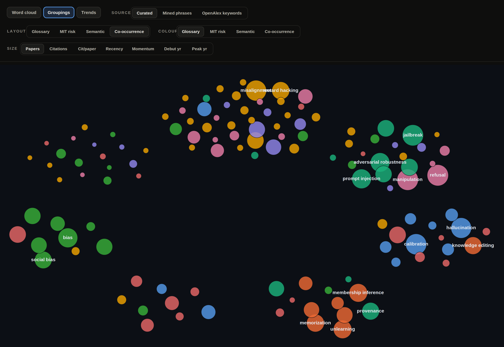
**Вид:** `🗂️ Groupings → Layout: Co-occurrence · Colour: Glossary · Size: Papers · Source: Curated`

Цвета (темы) те же, но теперь они **перемешаны** внутри каждого скопления: `jailbreak`
(бирюзовый, Attacks) висит рядом с `manipulation` и `refusal` (розовые, Interaction), потому
что их обсуждают вместе. Чистые острова рассыпались, и на глюк я это списать не смогла — цифры
раскладок сошлись с картинкой:

| раскладка | метрика качества | значение |
| --- | --- | ---: |
| ручная тема (Glossary) | spread-разделение, меньше — чище | 0.23 |
| co-occurrence | модулярность кластеров | 0.41 |
| семантика (эмбеддинги) | spread-разделение, меньше — чище | 0.48 |

Самая мутная раскладка — семантическая, и это та самая, которой я собиралась проверять ручную.

Совсем ярко несогласие линз видно на **«терминах-хамелеонах»** — их четыре линзы относят в
четыре *несвязанных* семьи. `sycophancy`: Interaction / HCI / bias & fairness / Alignment.
`refusal`: Interaction / HCI / refusal & jailbreak / Attacks. То же с `reward
overoptimization`, `toxicity`, `probing`, `weak-to-strong generalization`. У меня для каждого из
них в глоссарии стоит **одна** тема, выбранная руками, и карта её послушно повторяет. Какую из
четырёх ставить `sycophancy`, я решала на глазок и обратно к этому решению не возвращалась.

---

## 11. У AI safety нет своей полки ни в одной таксономии

Я шла за внешним источником баззвордов — хотела список, который не я составила. Пошла по полкам,
и полки не нашлось:

| где искала | что там вместо категории safety |
| --- | --- |
| arXiv | категории «AI safety» нет вовсе; статьи лежат в `cs.CL`, `cs.CR`, `cs.LG`, `cs.AI` |
| OpenAlex | в топе ключевых слов `computer science`, `artificial intelligence`, `psychology`, `political science`, `medicine`, `law` |

Вторую строчку я сначала прочитала как факт про поле. Зря: OpenAlex выдаёт свои ярлыки, а не то,
как статья называет себя, так что размазанность тут отчасти его собственная.

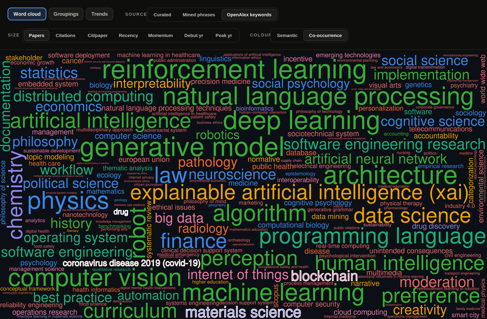

*Те же safety-статьи глазами OpenAlex: крупнейшее — reinforcement learning, deep learning,
natural language processing, а следом physics, law, finance, chemistry. Подсвечены совсем
чужие ярлыки — covid-19, drug, materials science, blockchain. Слов «safety», «alignment»
или «jailbreak» на этой карте нет ни одного.*
**Вид:** `🧭 Word cloud → Source: OpenAlex keywords → Size: Papers → Colour: Co-occurrence`

Оставалась таксономия рисков MIT. Наложила на неё свой концепт-глоссарий — и получила пять
доменов, где у меня нет вообще ничего: `Increased inequality and decline in employment quality`,
`Economic and cultural devaluation of human effort`, `Competitive dynamics`, `Governance failure`,
`Environmental harm`.

Пробел это или разные оси, я по этим пяти строчкам не различаю. Мой глоссарий набирался про
**свойства модели**, risk-таксономии написаны про **вред обществу и системам**, и `automated
decision-making` с `gradual disempowerment` в «свойство модели» не лезут, потому что они про
институты, а не про веса. Свести две оси в одну я пробовала дважды и оба раза бросила.

---

## 12. Слова несут моральную нагрузку — и поле это знает

Разметка `hallucination` встала на терминологической войне. Часть поля это слово не берёт. У людей
галлюцинация — про восприятие, говорят они, и на какой из двух записей надо было строить
цитируемость из §3, я так и не решила. Те же статьи идут у них под `confabulation`. В корпусе живут
обе записи: либо выбирать одну, либо считать обе.

Разложила ближайшие синонимы по тому, сколько умысла каждый приписывает модели:

| слово | сколько умысла приписывает модели |
| --- | --- |
| `ошибка` | нисколько |
| `hallucination`, `miscalibration` | почти нисколько |
| `sycophancy`, `deception` | заметно |
| `scheming` | больше всех |

Порядок строк наверху — моё чтение слов, а не измерение, и `miscalibration`, о котором не спорит
никто, стоит в нём двумя строчками выше `sycophancy`.

Уже посреди разметки я прочитала *The Ghost in the Grammar*
([arXiv:2603.13255](https://arxiv.org/abs/2603.13255)). Там сказано, что safety-литература
**сама методологически антропоморфна**: модели описаны через «намерения» и «схемы». Что делать
с таблицей выше после этой статьи, я пока не поняла.

---

## 13. Пропущенные синонимы двигают числа сильнее, чем шум

Фильтр шума я запускала в расчёте, что он сдвинет метрики §2. Почти не сдвинул. Сдвинули их
статьи, которые я всё это время молча выбрасывала.

Нашла это руками, а не тестом: читала абстракты подряд и споткнулась на статье, которая явно про
запоминание, а в счёте её нет. Сколько таких я пропустила, не знаю — знаю только про те, которые
пошла искать. `biased` и `biases` мне достались бесплатно, потому что я матчила по префиксу `bias`,
а статью, где написано `hallucinate` и ни разу `hallucination`, я не получила вовсе.

Во второй проход я матчила по смыслу. Ранжировала фразы корпуса по тому, насколько
их статьи близки к статьям самого термина на эмбеддингах SPECTER2. Одобряла формы по одной,
глазами, и где сомневалась — выбрасывала, так что верхняя граница тут снова моя.

| термин | статей было | стало | сдвиг |
| --- | ---: | ---: | ---: |
| `memorization` | 526 | 837 | +59% |
| `hallucination` | без изменений | без изменений | +0 |

*`memorization` — самая крупная одиночная починка, и вся она вышла из двух словоформ,
`memorize` и `memorized`. `hallucination` стоит в таблице ровно потому, что не вернул
ничего. По всему корпусу: **+741 верифицированная статья (+8.4%)** на 37 терминах.*

Ноль в строке `hallucination` — проблема не матчинга, а выкачки. Проход находит заново только те
статьи, что уже вытащил исходный запрос. Для `hallucination` синонимные статьи не выкачались
вовсе. То есть у полноты две дыры: пропущенные формы слова и статьи, которых запрос не достал.
Починка закрывает первую. Для второй надо перезапускать запросы, а этого я не делала.

Формы ещё и протекают между концептами. `harmful content` ушёл в *harmfulness* и притащил за
собой jailbreak-статьи. `factual knowledge` затянул RAG в *factuality*. Та же ловушка омонимов,
что в §2, только с обратной стороны. Теперь я проверяю каждую добавленную форму по статьям,
которые она за собой тянет. Начала, правда, уже после того, как эти две проскочили.

---

## Как это читать (шпаргалка на будущее)

Про любой safety-концепт я теперь задаю четыре вопроса. Все четыре вылезли из промахов выше.

1. **Слой** — про выход модели или про её внутренности? Это пара `refusal` из §1: с одной
   стороны оценка на бенчмарке, с другой — направление, вытащенное из residual stream.
2. **Capability или propensity** — может или станет? На этом я спотыкаюсь чаще всего.
   `attack success rate` считает, можно ли модель к чему-то подтолкнуть, `sycophancy` говорит,
   что она сползает туда сама. Может сделать или сделает. Я раскладывала статьи по одной из
   сторон на глазок.
3. **Операционализация** — какой конкретно датасет? `harmful content` чуть выше как раз такой
   случай: «harm» в названии, и ничего внутри о том, какой именно вред и кто его мерил.
4. **Кто судит** — человек, классификатор, LLM-судья? Мой собственный разбор, классификатор и
   LLM на одном и том же тексте расходятся достаточно часто, чтобы я стала помечать, кто из трёх
   выдал число, которое я записываю.

Три страницы живут тут:
[mrswallbreakermaps.com/buzzwords](https://mrswallbreakermaps.com/buzzwords/index.html).
Полный разбор всех 125 концептов — в [глоссарии](ai-safety-concepts-glossary.md),
методология сбора — в [methodology.md](methodology.md).
